# Mayaform

Mayaform is a classroom platform for cultural exchange. Teachers publish Agents,
Teams, and Knowledge; students talk with those Agents in text and take formal
assessments. A separate Debate classroom can run a fixed four-round discussion
with optional live audio. The public site is [https://app.mayaform.net/](https://app.mayaform.net/).

## 这是什么

Mayaform 把一门课里的 Agent、资料和测评放在同一套账号下面。教师编写 Agent 与
Team，用 RAG 和 Knowledge 组织课件与题库，在 Chatform 里和学生对话，并在
Record 里查看正式测评。学生注册后进入自己的小组，与已发布的 Agent 或 Team
文字聊天；说「正式测评」后，由 Team 里的 Guide、Scorer 和 Summarizer 按服务器
规则出题、记录和总结。界面文案是英文。辩论发言和测评内容可以是中文或英文，
那是另一项设置，不改变界面语言。

本地 Demo 会放上老子、柏拉图、苏格拉底三个示例 Agent。公网部署关掉 Demo
身份切换，使用独立的数据库、配置目录和教师账号。

## 教师和学生各自看到什么

侧栏分成四块：**Studyform**、**Brainform**、**Chatform**、**Classroom**。

| 模块      | 教师                                         | 学生                                     |
| --------- | -------------------------------------------- | ---------------------------------------- |
| Studyform | Agents、Teams。创建并发布 Agent 和 Maya Team | 查看本组 Agent，以及课程里可用的 Team    |
| Brainform | RAG、Voices、Record、Knowledge               | RAG、Voices、Record（自己的作答）        |
| Chatform  | 与 Agent 或 Team 文字聊天                    | 同样的文字聊天。正式测评写在 Team 聊天里 |
| Classroom | Debates、Accounts                            | Live。老师进入课堂后入口才会亮           |

Accounts 可以查看成员、改显示名、调组、停用或重置密码。教师对某个小组点
Enter 时，只是临时以只读身份查看该组的公开资料，离开后这层临时成员关系会删掉。
聊天记录只属于本人。

Knowledge 是规范化的题库与讲义（Concepts、Questions、Notes、Graph），由教师
保存、生成或重新生成。测试里把「一个 Agent 对应一份 canonical Knowledge」称为
Courser-class Agent。界面上没有单独的 Courser 页面，入口就是 Agent 和 Knowledge。

### 正式测评

一次正式测评挂在已发布的 Team 上，角色写在 Guide 的 `# Team Ruleset` →
`## Formal assessment` 里：`question_guide`、`scorer`（同时是 `answer_recorder`）
和 `summarizer`。学生说出「正式测评」或对应的英文句子后，Guide 先读共享
Knowledge 里的 `## Opening` / `## 开场白`，再出第一题。Scorer 记录答案并按
Rubric 评分；题目全部答完后 Summarizer 说「正在总结答案」，并把结果分成已掌握、
薄弱和尚未验证。教师在 Record 里按学生、Team 和时间查看，不看原始聊天。
放弃会删掉这一次的学习记录，已经发生的模型调用账本仍然保留。

普通聊天不进入 Record。Chatform 只出文字，不在聊天回复后播放语音。

### 辩论课堂

Debates 仍是固定四轮：Opening、Discussion、Response、Conclusion。前三轮可以
先准备文字和音频，第四轮结合课堂消息现场生成。Immerse 是全屏课堂，没有手动
暂停弹幕的按钮；进入 Final 时会停止收集新消息。音频失败时文字仍然保留。

## 界面

下面的图来自本地 Mock Demo（`LLM_PROVIDER=mock`），使用示例 Agent 和一个新建的
小组账号。图里没有密码，也没有真实姓名。侧栏底部的联系地址在截图前被拿掉了。
本地 Mock 不会跑完一场正式测评：测评进行中如果模型仍是 mock，服务器会拒绝这一轮。
因此 Record 和新生的 Chatform 是空的；能看到的对话是教师和示例 Agent 的普通聊天，
回复原文是 `Mock · Socrates`。

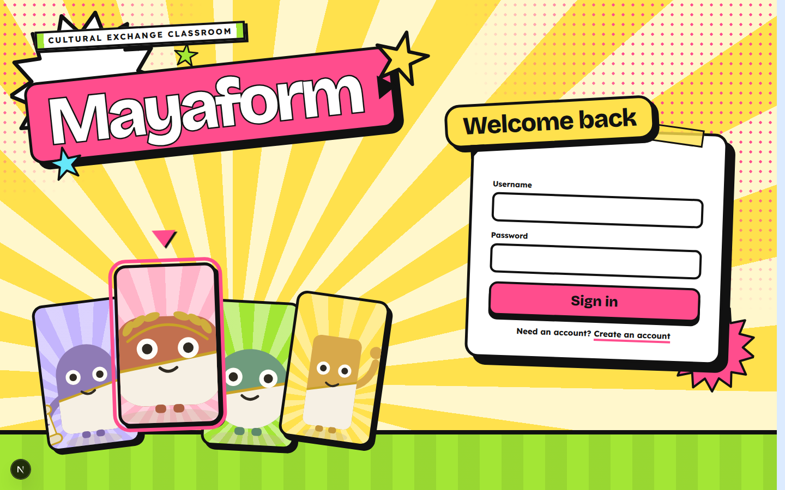

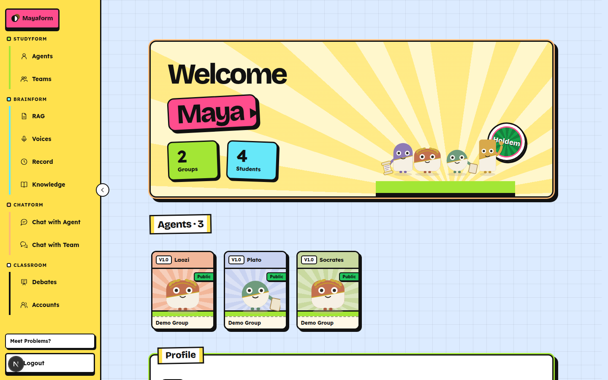

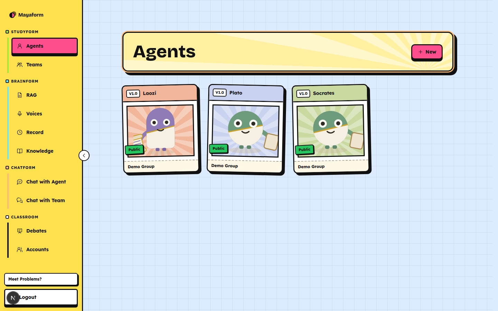

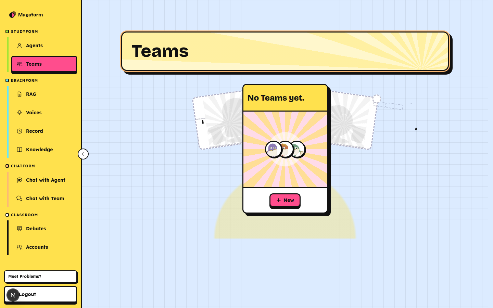

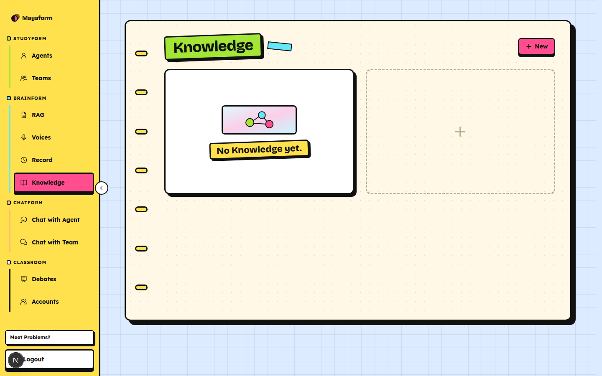

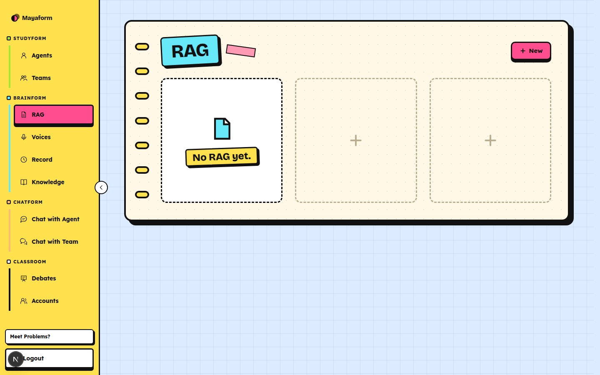

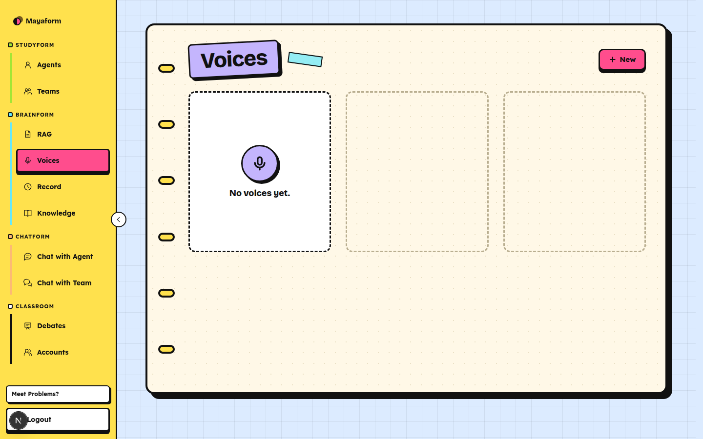

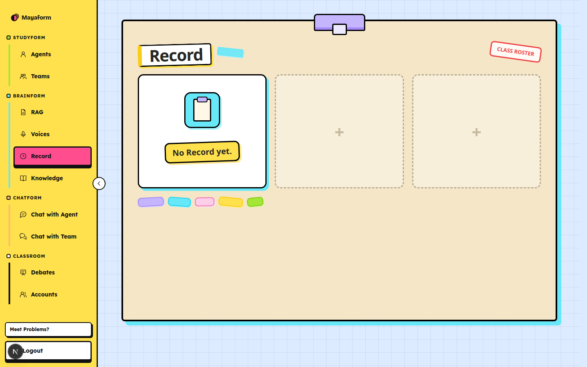

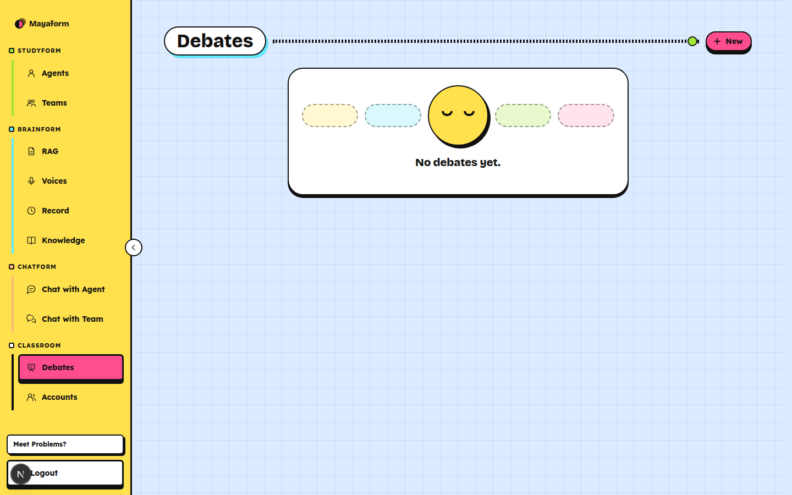

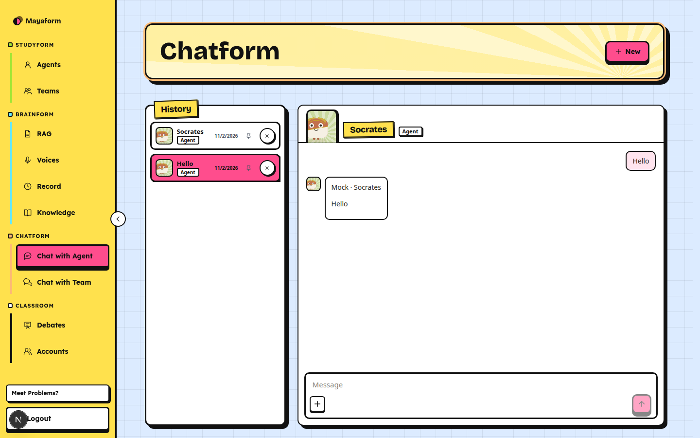

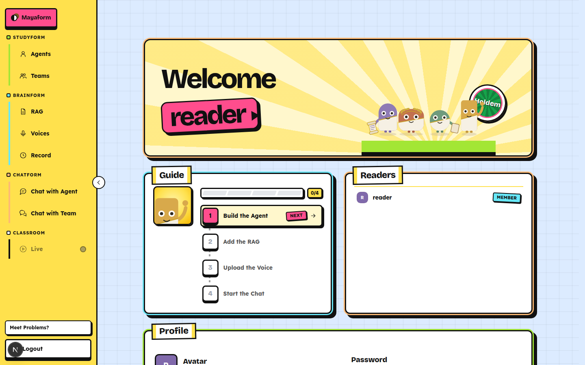

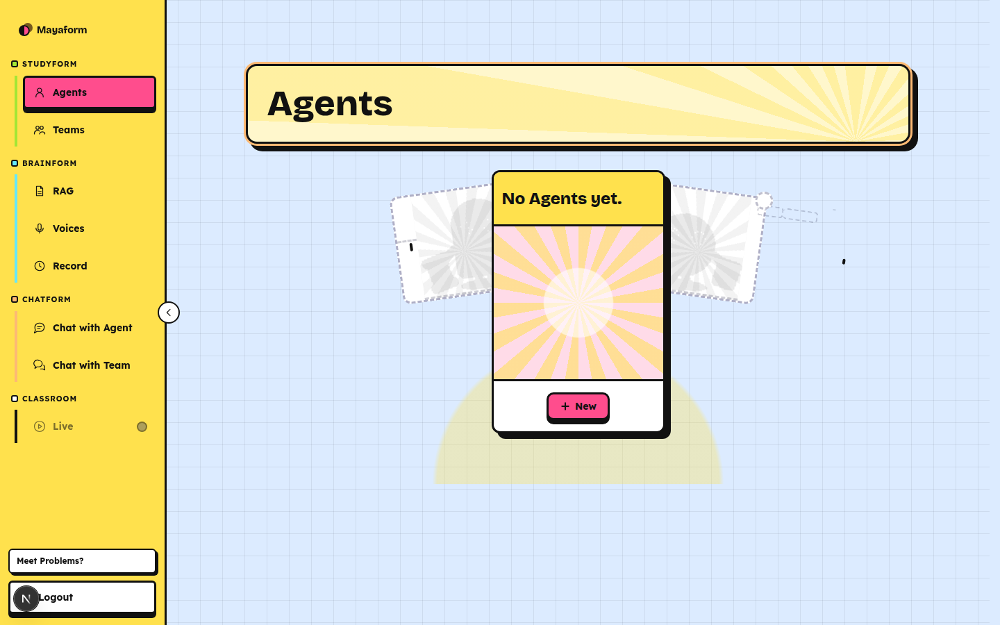

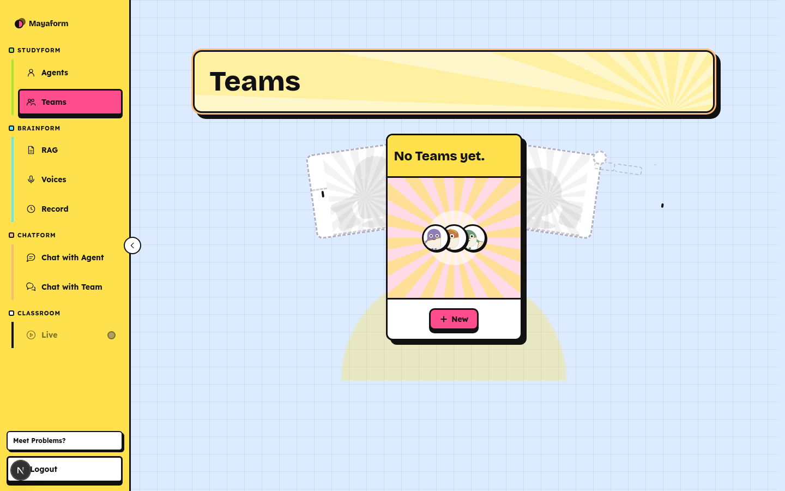

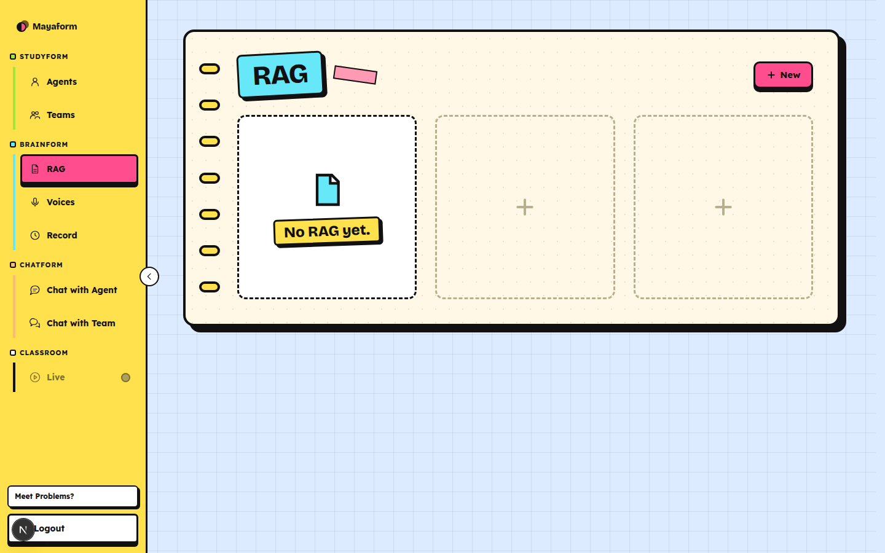

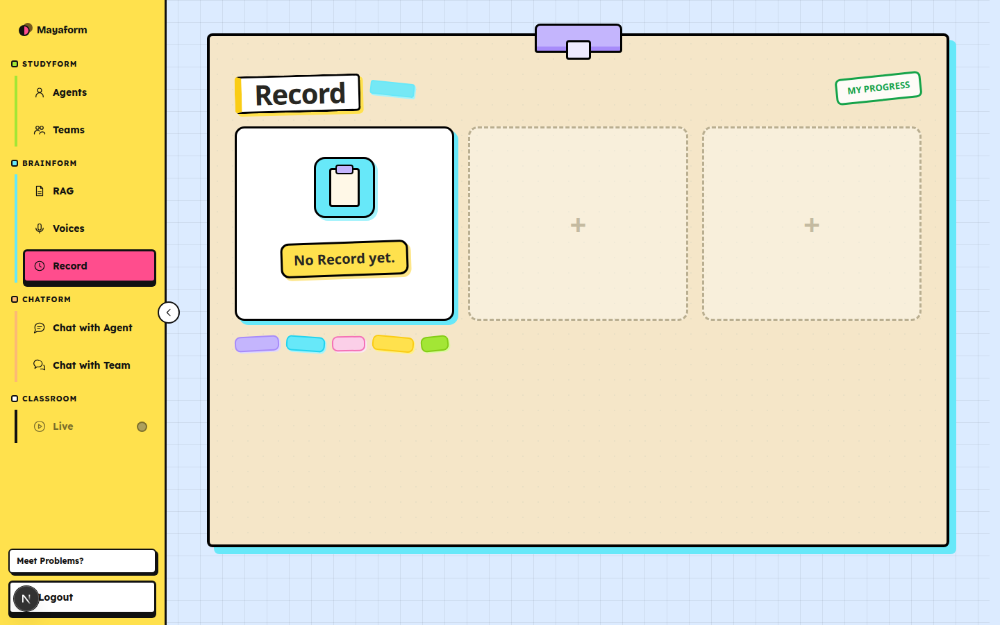

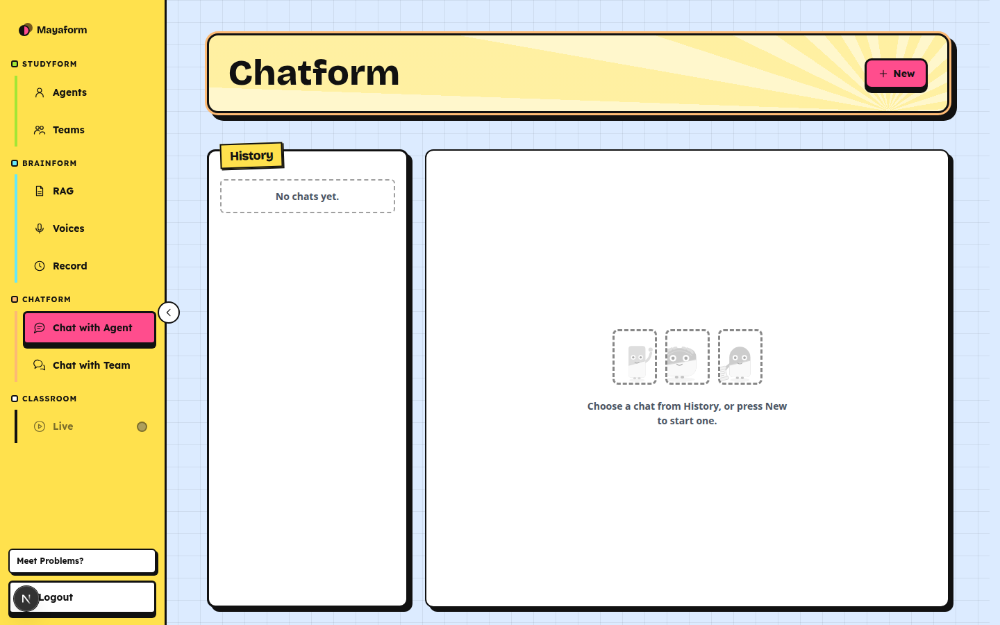

## 架构

本地 Demo 是四个容器，浏览器只访问同一个来源。

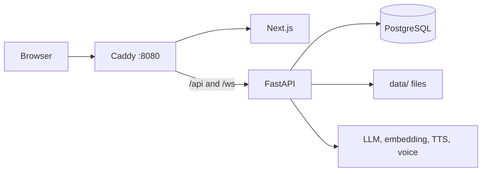

- 浏览器只调用本平台的 REST 和 WebSocket。供应商地址、密钥、模型内部 id 和
  文件路径留在后端。
- PostgreSQL 是唯一数据库。SQLite 连接串会被拒绝。Markdown 和音频放在受控的
  `data/` 目录，不放进 Git。
- Agent 发布后版本不变。辩论和测评冻结当时的 Agent 版本与 Knowledge 快照。
- LLM、Embedding、TTS、声音克隆和翻译都是后端适配器。未配置时用 mock，不访问外网。

生产环境用 `docker-compose.production.yml` 盖住端口和 Demo 开关：Caddy 监听
80/443，后端默认两个副本，PostgreSQL 不映射到公网。挂起的后端由 `autoheal`
按健康检查重启。

## 技术栈

| 层          | 选择                                                                                 |
| ----------- | ------------------------------------------------------------------------------------ |
| 前端        | Next.js 16、React 19、Tailwind CSS 4。包管理是 pnpm 11.19.0，Node.js 24.14.0         |
| 后端        | FastAPI、SQLAlchemy、Alembic、Pydantic。Python 依赖用 uv                             |
| 数据        | PostgreSQL 16                                                                        |
| 网关        | Caddy 2                                                                              |
| 模型        | DashScope（通义）负责聊天、嵌入、语音合成和声音克隆；DeepL 负责翻译。都可以换成 mock |
| Team 运行时 | Agno 3.0.11，只使用公开 SDK                                                          |

当前迁移 head 写在 `backend/app/core/db.py` 的 `ALEMBIC_HEAD`。写这页时是
`0080_drop_playback_rate`。后端启动时会自己迁移到这个 head。

## 目录

```text
backend/          FastAPI 应用、Alembic 迁移、pytest
frontend/         Next.js 应用与 Vitest
contracts/        冻结的 OpenAPI 与 WebSocket schema
docs/             产品进度、架构、ADR、契约说明、截图
infra/            Caddyfile 与 autoheal
scripts/          检查、本地 bootstrap、压测与数据迁移
docker-compose.yml
docker-compose.production.yml
```

产品进度只记在 [docs/PROJECT.md](docs/PROJECT.md)。怎么改代码记在
[AGENTS.md](AGENTS.md)。架构说明在 [docs/ARCHITECTURE.md](docs/ARCHITECTURE.md)。

## 本地运行

需要 Docker、Git、Node.js 24.14.0、pnpm 11.19.0 和 uv。

```sh
git clone https://github.com/bowenx1125/maya-platform.git
cd maya-platform
pnpm install --frozen-lockfile
pnpm bootstrap:local
docker compose up -d --build --wait
```

`pnpm bootstrap:local` 会写两份被 Git 忽略的文件：仓库根目录的 `.env`，以及
`backend/config/demo-accounts/accounts.private.md`。已有文件不会被覆盖。
打开 [http://localhost:8080](http://localhost:8080)。Demo 教师用户名是 `maya`，
密码只出现在那份私有目录里，不要提交，也不要写进聊天或截图。

新环境默认全部是 mock，不需要 API key。学生也可以在登录页自己注册。

| 操作                     | 命令                                  |
| ------------------------ | ------------------------------------- |
| 启动                     | `docker compose up -d --wait`         |
| 停止                     | `docker compose stop`                 |
| 改完代码或 `.env` 后重建 | `docker compose up -d --build --wait` |
| 看状态                   | `docker compose ps`                   |

换过局域网地址后，课堂二维码要和浏览器实际打开的地址一致，包括端口：

```sh
uv run --directory backend python ../scripts/refresh_classroom_address.py
docker compose up -d --wait
```

只跑前端开发服务器时，Next.js 把 `/api` 和 `/ws` 代理到 `MAYA_API_PROXY`
（默认 `http://127.0.0.1:8000`）。这时候 `CLASSROOM_PUBLIC_BASE_URL` 必须是浏览器
里的那个来源，否则保存请求会被 CSRF 拒绝。日常验收仍以 Compose 的 8080 为准。

重置本地运行目录之前要先 `docker compose down`。`scripts/reset_demo_runtime.py`
是改名隔离，不是删除；容器如果还停在旧挂载上，会继续写进被隔离的那一份。

## 环境变量

只列出名字。值放在本机 `.env` 或服务器上的 `/protected/maya-production.env`，
不要提交。完整模板是 [.env.example](.env.example)。

本地和模型：

- `DEMO_MODE`、`DEMO_QUICK_LOGIN`、`DEMO_AUTO_CONFIRM_PROVIDER`
- `PROVIDER_STANDING_CONSENT`
- `SESSION_SECRET`、`SESSION_TTL_DAYS`
- `CLASSROOM_PUBLIC_BASE_URL`
- `DATABASE_URL`、`DATA_ROOT`、`POSTGRES_PASSWORD`
- `DEMO_USERS_FILE`、`DEMO_ACCOUNTS_FILE`、`ALLOW_LEGACY_DEMO_USERS`
- `MAYA_ENV`、`NODE_ENV`
- `LLM_PROVIDER`、`MAYA_REPORT_PROVIDER`、`EMBEDDING_PROVIDER`、`TTS_PROVIDER`、`VOICE_PROVIDER`
- `DASHSCOPE_API_KEY`、`DASHSCOPE_CHAT_API_KEY`、`DASHSCOPE_WORKSPACE_ID`、`DASHSCOPE_REGION`
- `LLM_MODEL`
- `EMBEDDING_PROVIDER_POLICY_HASH`、`LLM_PROVIDER_POLICY_HASH`、`REPORT_PROVIDER_POLICY_HASH`、`PROVIDER_POLICY_HASH`
- `DEEPL_API_KEY`
- `FALLBACK_VOICE_PROFILE_ID`、`VOICE_CLONE_MODEL`、`BASELINE_DEFAULT_VOICES`
- `DEBATE_LLM_MODEL`、`DEBATE_LLM_TEMPERATURE`、`DEBATE_LLM_TOP_P`、`DEBATE_LLM_PRESENCE_PENALTY`、`DEBATE_LLM_FREQUENCY_PENALTY`、`DEBATE_LLM_REPETITION_PENALTY`、`DEBATE_LLM_MAX_TOKENS`、`DEBATE_LLM_ENABLE_THINKING`、`DEBATE_LLM_SEED`、`DEBATE_LLM_TIMEOUT_SECONDS`
- `DEBATE_TTS_MODEL`、`DEBATE_TTS_RATE`、`DEBATE_TTS_INSTRUCTION`、`DEBATE_TTS_SEED`
- `DEBATE_AUDIO_MP3`、`DEBATES_BETA_LIVE_INTERACTION`
- `NEXT_PUBLIC_RUNTIME_MODE`、`NEXT_PUBLIC_BUILD_SHA`

生产额外需要：

- `MAYA_DOMAIN`、`ACME_EMAIL`
- `MAYA_PRODUCTION_DATA_DIR`、`MAYA_PRODUCTION_CONFIG_DIR`、`MAYA_PRODUCTION_ACCOUNTS_FILE`
- `BACKEND_REPLICAS`
- 登录与写入排队：`AUTH_LOGIN_QUEUE_RETRY_SECONDS`、`AUTH_LOGIN_ACCOUNT_FAILURE_LIMIT`、`AUTH_LOGIN_CLIENT_FAILURE_LIMIT`、`AUTH_LOGIN_FAILURE_WINDOW_SECONDS`、`AUTH_REGISTER_CLIENT_LIMIT`、`AUTH_REGISTER_WINDOW_SECONDS`、`AUTH_ABUSE_MAX_BUCKETS`、`AUTH_HASH_CONCURRENCY`
- 自适应准入：`ADAPTIVE_ADMISSION_ENABLED` 以及同前缀的限额、内存和负载阈值。默认值写在 Compose 生产文件里

真实模型还要一份审核过的 provider policy。步骤在
[docs/REAL_PROVIDER_SETUP.md](docs/REAL_PROVIDER_SETUP.md)。只改 `LLM_PROVIDER`
或只填 API key 不够。

## 测试

GitHub Actions 工作流是 `.github/workflows/wave0.yml`，在 pull request 和手动触发时跑。
它不读取生产密钥。数据库是工作流里临时的 PostgreSQL。

本机一次跑完与 CI 相同的确定性检查：

```sh
pnpm check
```

`pnpm check` 会要求已经设置 `MAYA_TEST_POSTGRES_URL`，指向一台测试用的
PostgreSQL。每个测试使用自己的数据库。后端测试必须在 `backend/` 目录里跑，
否则会读到仓库根目录的 `.env`，CSRF 相关测试会因为本机配置失败。

可以拆开跑：

```sh
cd backend && uv run ruff check . && uv run ruff format --check app tests migrations && uv run mypy app
cd backend && uv run pytest -p no:warnings
pnpm frontend:lint && pnpm frontend:typecheck && pnpm frontend:test
pnpm --filter @maya/frontend build
```

契约和仓库边界：

```sh
pnpm docs:check
node scripts/check_frozen_openapi.mjs
node scripts/check_generated_contracts.mjs
node scripts/check_generated_ws.mjs
node scripts/check_openapi_responses.mjs
node scripts/check_repo_boundary.mjs --probe-generated
uv run --directory backend python ../scripts/export_fastapi_openapi.py /tmp/maya-openapi.json
node scripts/compare_route_surface.mjs --server-openapi /tmp/maya-openapi.json
```

`tests/test_wave3_knowledge.py::test_two_database_threads_concurrent_replace_have_one_winner`
会抢两次写入，大约三次里有一次失败。先重跑再把它当成回归。

另一项 CI 作业 `login-load-regression` 会启动 API，注册一批 `loadtune-*` 账号，
再跑 `scripts/load_tune.py --profile login-ci`。

## 部署到 app.mayaform.net

先把要发布的提交推进 GitHub `main`。生产只从已经在 GitHub `main` 上的提交构建。
主机、SSH 和发布顺序写在 [AGENTS.md](AGENTS.md) 第 8 节；证书、账号目录和
Demo 开关写在 [docs/RELEASE_POLICY.md](docs/RELEASE_POLICY.md)。

概要：

1. 在 `maya-production-postgres-1` 里执行 `pg_dump -U maya -Fc maya`，把备份放到
   `/srv/maya-production/backups/`，并用 `pg_restore --list` 确认能读。
2. 更新服务器上的 `/opt/maya-platform`。
3. 用受保护的环境文件启动，不要把该文件提交进 Git：

```sh
docker compose --project-name maya-production \
  --env-file /protected/maya-production.env \
  -f docker-compose.yml -f docker-compose.production.yml \
  up -d --build --wait
```

4. 确认容器健康、`/health/ready`、Alembic head，以及
   `https://app.mayaform.net/` 返回 200。

不要执行 `docker compose down -v`。不要把 Demo 的数据目录、账号目录或密码用到
公网。生产配置里 `DEMO_MODE`、`DEMO_QUICK_LOGIN` 和 `DEMO_AUTO_CONFIRM_PROVIDER`
都是关闭的。`PROVIDER_STANDING_CONSENT=true` 只表示运维已经做过一次供应商同意，
每一次外发仍然单独记账，未知结果不会自动重发。

只改文档的提交可以更新 Git 树，不必为此重建容器。

## 相关文档

- [工作约定](AGENTS.md)
- [产品进度](docs/PROJECT.md)
- [架构](docs/ARCHITECTURE.md)
- [发布要求](docs/RELEASE_POLICY.md)
- [真实模型配置](docs/REAL_PROVIDER_SETUP.md)
- [接口契约](contracts/openapi-v0.1.yaml)
