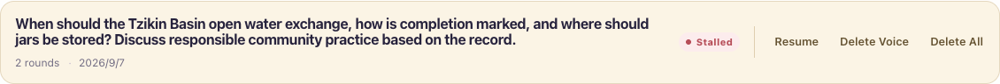
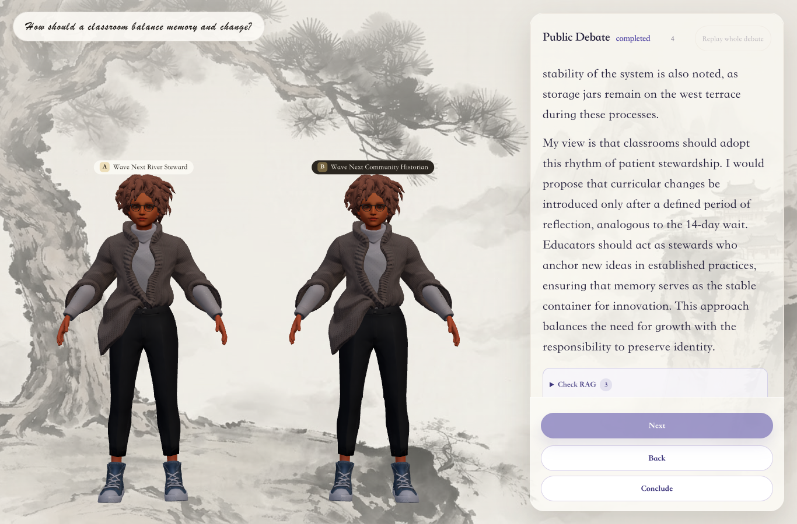

# Maya Teaching Platform

面向 RAG 教学的课堂辩论系统：学生编写 Agent 人设和知识文档，教师安排 2–5 位 Agent、2–5 轮中英文辩论。Preview 保存前 N−1 轮正文和音频，最后一轮在课堂结合弹幕生成；Conclude 汇总证据评分，再按需生成 Report。




## 首次启动

准备好 **Docker Desktop、Git、Node.js 24.14 或更新的 24.x、pnpm 11.19.0 和 uv**，并启动 Docker Desktop。使用 `main` 分支：

```sh
git clone https://github.com/bowenx1125/maya-platform.git
cd maya-platform
pnpm install --frozen-lockfile
pnpm bootstrap:local
docker compose up -d --build --wait
```

Bootstrap 首次设置演示密码和私有配置，已有配置不会被覆盖。打开 [localhost:8080](http://localhost:8080)，选择教师 **Maya**。默认使用 Mock，无需 API Key；`uv` 会准备后端 Python 环境。

## 日常操作

以下命令都在 `maya-platform` 目录执行，普通启停保留数据。启动或重启后，等待 `docker compose ps` 中 backend / frontend 显示 healthy。

| 操作           | 命令                                                             |
| -------------- | ---------------------------------------------------------------- |
| 启动           | `docker compose up -d --wait`                                    |
| 重启，配置不变 | `docker compose restart`                                         |
| 关闭           | `docker compose stop`                                            |
| 拉取更新并重建 | `git pull --ff-only`，然后 `docker compose up -d --build --wait` |
| 查看状态       | `docker compose ps`                                              |
| 查看最近日志   | `docker compose logs --tail=80 backend frontend`                 |

修改 `.env` 后执行 `docker compose up -d --wait`，让配置进入新容器。更换 Wi-Fi 后，用 `uv run --directory backend python ../scripts/refresh_classroom_address.py` 更新课堂地址，再执行上述命令。学生手机和教师电脑需要在可互通的局域网内。

## 一次课堂

1. 学生创建 Agent，编写五分区人设 MD，上传知识文档，Compile → Confirm → Publish。
2. 教师在 **Debate List** 创建辩论，选择语言、轮数及 Agent 发言顺序。Preview 全部准备好后，点击 **Open Classroom**。
3. 课堂中 **Start / Next** 控制播放；**Open Message / Hide** 显示或收起大二维码。Hide 不关闭入口，已扫码学生仍可发弹幕；最后一轮前冻结消息供 Agent 回应。
4. **Check RAG** 展示段落和来源。Agent 评分按直接证据 **+5**、间接证据 **+2**、No match **+0** 累计，旧版未记录等级的段落显示 Unscored。等级是教学记录，质量仍需结合原文判断。
5. **Conclude** 完成本场并显示评分；**Generate Report** 单独生成报告。

**Resume、Delete Voice、Delete All** 位于 Debate List 同一张卡片内。Delete Voice 只清理该场音频，可从保存的正文重新生成；Delete All 清理该场运行记录，不删除学生编写的 Agent 和知识库。

## Mock ↔ Real

编辑本地 `.env` 中的三个开关：

```dotenv
LLM_PROVIDER=dashscope
MAYA_REPORT_PROVIDER=dashscope
EMBEDDING_PROVIDER=dashscope
```

切回 Mock，将三个值都改成 `mock`。两种切换都执行：

```sh
docker compose up -d --wait
```

首次启用 Real 还需要在 `.env` 配置 DashScope 凭据、区域、价格卡和已审核的 Provider policy，并完成教师披露确认；详见 [Real 配置](docs/REAL_PROVIDER_SETUP.md)。API Key 不能代替这些配置。切换后需重新发布带真实 Embedding 的知识快照，原有 Mock 快照保持原身份；TTS / Voice 当前仍为 Mock 接口。教师首页会显示各模块实际模式。

## 开发与验收

`pnpm check` 执行本地确定性检查。完整的真实服务、RAG 语义、音频和 3D 验收进展以 [PROJECT](docs/PROJECT.md) 为准，本地检查通过不代表真实验收全部通过。

[工作约定](AGENTS.md) · [下一 Wave 方案与验收标准](docs/contracts/NEXT_WAVE_PLAN.md) · [人工检查](docs/requirements/MANUAL_VERIFICATION.md)

`.env`、私有账号、Provider policy、`data/` 和生成音频均不提交 Git。运行数据位于本地 `data/`，请按需要备份。
