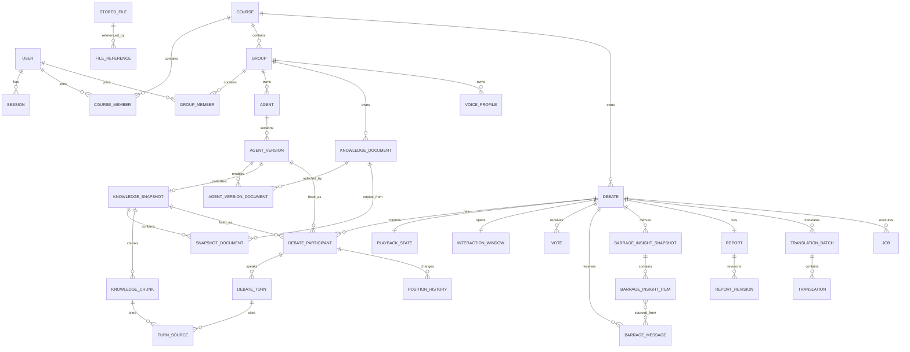

# Maya Demo v0.1 G0 产品与技术合同

合同版本：`g0-2026-08-28.6-manual-acceptance-delta`（历史已签基线：`g0-2026-08-27.5`）  
状态：`C01-C10 BASELINE FROZEN / WAVE 2 MANUAL-ACCEPTANCE DELTA FROZEN — SOL HIGH G0-S PASS / G1 AUTHORIZED`  
范围：C01、C02、C04-C10  
不包含：产品源码、数据库迁移代码、前端组件、Provider 实现

## 统一术语与不变量

- `User` 只表示教师或学生制作账号；课堂观众不是 User。
- `Group` 是学生内容隔离边界；同课程其他小组学生对目标对象统一得到 `404 not_found`。
- `Agent` 是稳定身份；`AgentVersion` 是唯一草稿或不可变发布版本。
- `KnowledgeDocument` 归属 Group；只有同组 AgentVersion 草稿可明确启用。
- `KnowledgeSnapshot` 只能在发布成功时创建，一经绑定不可修改。
- `DebateParticipant` 在辩论草稿创建/修改时固定具体 AgentVersion 与 KnowledgeSnapshot；启动后不可改变。
- `Maya` 是系统报告 Agent，不属于学生小组、A-E 参辩字母槽位、辩论 turn、3D 或投票。
- 大屏保留原始昵称弹幕；Maya 只读取去昵称并验证过的 BarrageInsightSnapshot。
- 前端只认识 `/api/v1` 的平台 DTO，不认识模型、向量库、TTS 或声音供应商字段。
- OpenAPI 是唯一 HTTP 契约；本文件解释业务不变量，不能与 OpenAPI 产生第二套字段定义。
- 禁止直接复制粘贴参考项目代码；任何实现从本合同重新设计。

---

# C01 Scope、页面地图与关键线框

## C01.1 Demo 内页面

| Route | 页面 | 使用者 | 核心任务 |
| --- | --- | --- | --- |
| `/login` | 登录/快速切换 | 教师、学生 | 用户名密码登录；Demo Mode 下后端身份切换 |
| `/student` | 学生首页 | 学生 | 查看预置课程、本组和当前工作概况 |
| `/student/groups/{group_id}` | 小组工作台 | 本组学生 | 多 Agent、组内 MD、音色、成员只读概览 |
| `/student/groups/{group_id}/agents/new` | 创建 Agent | 本组学生 | 创建 Agent + V1.0 草稿 |
| `/student/agents/{agent_id}` | Agent 工作台 | 本组学生 | 继续草稿、版本、归档、发布状态 |
| `/student/agent-versions/{version_id}/edit` | Agent 草稿编辑 | 本组学生 | AGENT.md、RAG 启用集、3D、音色、测试聊天、发布 |
| `/student/groups/{group_id}/knowledge` | 组内 Markdown 资料库 | 本组学生 | 上传、下载、索引状态、被哪些本组草稿启用 |
| `/student/groups/{group_id}/voices` | 小组音色 | 本组学生 | 上传一段音频、状态、试听、删除、绑定提示 |
| `/teacher` | 教师课程首页 | 教师 | 当前课程、小组、当前发布 Agent、最近辩论 |
| `/teacher/agents/{agent_id}` | 已发布成果详情 | 教师 | 当前/历史发布版本完整冻结内容；不显示草稿 |
| `/teacher/debates` | 辩论列表 | 教师 | 草稿、运行中、历史记录 |
| `/teacher/debates/new` | 创建辩论 | 教师 | 议题、按点击顺序 2-5 Agent、立场模式、预计时长；Maya 固定启用 |
| `/teacher/debates/{debate_id}/control` | 教师控制台/大屏 | 教师 | 启动、播放控制、3D、互动、洞察、Maya 报告 |
| `/teacher/debates/{debate_id}/history` | 辩论历史 | 教师 | transcript、来源、原始弹幕、票数、报告修订、可回放状态 |
| `/classroom/{access_token}` | 免登录手机表单 | 课堂观众 | 先填昵称，再独立投票/弹幕；不看课堂大屏内容 |

不存在的 Demo 页面：课程创建/加入、建组/邀请/角色管理、PDF/TXT 上传、知识正文在线编辑、历史版本回滚、评分、Evaluation、音频下载、Maya 3D/TTS。

## C01.2 全局导航

学生导航：`Home / Group Workspace / Agents / Knowledge / Voices / Language / Logout`。

教师导航：`Course / Published Agents / Debates / History / Language / Logout`。

观众页无应用导航、无账号入口、无返回教师端链接。

所有登录页均显示当前 `ui_locale`；切换界面语言不得改变英文内容、RAG、TTS 或报告。

## C01.3 学生 Agent 工作台线框

```text
┌ Group / Agent name / Draft V1.1 / revision 12 / Unpublished changes ┐
│ [AGENT.md] [RAG] [3D Head] [Voice] [Test] [Publish checklist]       │
├──────────────────────────────────────────────────────────────────────┤
│ 左：当前步骤编辑区                   右：状态与教学解释              │
│ - Markdown editor / file chooser        - What this teaches          │
│ - enabled document list                 - current blockers           │
│ - avatar preview                        - effective voice            │
│ - test chat + retrieved sources         - revision conflict warning  │
├──────────────────────────────────────────────────────────────────────┤
│ [Save draft] [Preview] [Publish update]                               │
└──────────────────────────────────────────────────────────────────────┘
```

规则：

- 已发布版本页只读；没有草稿时显示“创建新版本”，不能出现“编辑已发布版本”。
- 草稿保存必须携带 `expected_revision`；冲突时保留本地未提交文本并要求刷新/重新应用。
- RAG 页只显示本组资料；上传到当前草稿时默认启用，其他 Agent 不自动启用。
- “从当前草稿移除”只删除 AgentVersion 关联；“从组资料库隐藏”是独立操作，仍被其他活跃草稿启用时返回 409，发布快照永不删除。
- 发布按钮只由后端 `publish_blockers[]` 决定；前端检查仅为提示。
- 归档需要确认；归档后默认列表隐藏，单独过滤器可查看并取消归档。

## C01.4 教师创建辩论线框

```text
┌ Topic (English, required) ───────────────────────────────────────────┐
│ [                                                                  ]│
├ Current published agents ────────────────────────────────────────────┤
│ Click order: [Bowen]→A  [KaiKai]→B  [+ agent]                        │
│ A. Bowen Agent   [Assigned/Open] [Support/Oppose/Neutral] [note]     │
│ B. KaiKai Agent  [Assigned/Open] [Support/Oppose/Neutral] [note]     │
├ Fixed demo rules ─────────────────────────────────────────────────────┤
│ 2 rounds · 80-200 words · estimated duration only · Maya enabled      │
├───────────────────────────────────────────────────────────────────────┤
│ [Save draft] [Create and lock snapshot]                               │
└───────────────────────────────────────────────────────────────────────┘
```

- 不提供轮数、总时长或单回合硬时长输入。
- 英文议题使用确定性的 Latin-script 门禁：trim 后非空且至少包含一个拉丁字母；允许 Unicode 拉丁变音、数字、标点和普通 Unicode 空格，拒绝非拉丁文字、控制/格式字符、符号、孤立组合符和非空格分隔符；不设置产品级最大长度。创建和修改在任何幂等/CAS/参与者替换前校验，启动对历史非法草稿在音频清理、计划、Job、Provider 和状态写入前再次校验。
- 取消并重新点击才改变顺序；不另设编号或拖拽排序器。
- 归档 Agent、无当前发布版 Agent、其他课程 Agent 不出现在候选列表。
- Maya 是固定收尾能力，只显示说明，不提供启用/关闭开关。
- 保存/修改辩论草稿会重新固定当时的当前 AgentVersion/Snapshot；启动后全部锁定。

## C01.5 教师课堂大屏线框

```text
┌ Topic · Round 1/2 · current-turn highlight · connection/status ─────┐
│                                                                      │
│    [A 3D head]   [B 3D head]   [C/D/E if selected]                  │
│     gold halo      attentive expression/motion                       │
│                                                                      │
│  Speech bubble: complete English turn                                │
│  RAG: matched / no_match    Sources: file-a.md, file-b.md            │
├ Evidence drawer ──────────────────────────────────────────────────────┤
│ source filenames and retrieved status                                │
├ Control dock ─────────────────────────────────────────────────────────┤
│ Start/Pause/Resume/Skip/Stop · Replay turn/all · Translate current   │
└───────────────────────────────────────────────────────────────────────┘
```

阶段覆盖：

1. `draft`：显示启动检查；
2. `running/preparing`：只显示准备状态，不泄漏下一位正文；
3. `playing/paused`：正式英文气泡、音频、3D 同时公开；
4. `debate_finished_waiting_interaction`：显示“打开课堂互动”；
5. `interaction_open`：同一舞台显示二维码、逐条昵称弹幕墙、匿名票数/占比；
6. `barrage_insight_generating`：原始弹幕仍可见，显示“正在整理课堂意见”；
7. `report_generating/ready/failed`：显示 Maya 报告或重试，不丢失辩论/互动；
8. `stopped/failed`：显示终态和已完成记录，不允许继续本场。

浏览器自动播放要求：教师第一次点击“Start”同时建立音频播放手势授权；未取得授权时后端状态不前进到正式 `playing`，页面显示“点击继续播放”。

| 综合状态 | 允许教师操作 |
| --- | --- |
| draft | 编辑、启动 |
| running + preparing/ready | 立即停止；不允许跳过尚未播放内容 |
| running + playing | 暂停、跳过当前剩余播放、立即停止 |
| running + paused | 继续、立即停止 |
| debate_finished + interaction.closed | 打开互动、整场/单回合重播、按需翻译 |
| interaction.open | 结束收集；禁用重播和翻译，避免覆盖二维码/互动舞台 |
| insight/report generating | 只查看进度；不打开新互动、不重播 |
| completed | 整场/单回合重播、按需翻译、重新生成报告、查看/下载 |
| failed/stopped | 查看已完成记录；不可继续、不可打开互动 |

重播的暂停/继续/跳过只控制 replay mode，不能把一个已经完成的 Debate 改成 stopped。

## C01.6 观众手机页线框

```text
Step 1: Nickname [____________] [Continue]

Step 2:
Vote (independent)                 Barrage (independent)
[A Bowen] [B KaiKai] [Submit]      [raw text________] [Send]
success/error/loading              success/error/loading
```

- 昵称只保存在页面状态并随弹幕 POST；投票 POST 不包含昵称。
- 一项成功只锁定该区域；另一项仍可提交。
- 两项完成后显示总体成功；刷新重新生成两个 client submission ID。
- 互动 finalized 后 GET/POST 都返回 `interaction_closed`；页面只显示“本场互动已结束”。
- 手机页不连接 WebSocket，不显示票数、弹幕墙、辩论内容、3D、报告或课程信息。

## C01.7 响应式与可访问性

- 教师大屏优先 16:9、1280×720 以上；低于 1024px 时证据面板折叠，2-5 个头脸自适应网格。
- 学生/教师普通页面支持 1024px 桌面；手机可以查看但不保证复杂 3D 编辑体验。
- 观众页以 360px 宽手机优先；按钮触控高度至少 44px。
- 所有控制有文本标签、键盘焦点、处理中/失败/禁用原因；不能只靠颜色表示 speaker/RAG/error。

---

# C02 ERD、约束与文件生命周期

## C02.1 逻辑 ERD



## C02.2 表与关键约束

所有 ID 为 UUID；时间为 UTC ISO-8601；API 按字符串传输。SQLite 开启 foreign keys、WAL、busy timeout。

| 表 | 关键字段 | 必须约束 |
| --- | --- | --- |
| `users` | id, username, display_name, status | username unique；不含密码明文 |
| `sessions` | id_hash, user_id, csrf_hash, expires_at | 只存 token hash；过期不可用 |
| `courses` | id, code, name, current_audio_debate_id | code unique；Demo seed 幂等；音频场次指针用于安全替换 |
| `course_members` | course_id, user_id, role | unique(course_id,user_id)；role teacher/student |
| `groups` | id, course_id, name | unique(course_id,name) |
| `group_members` | group_id, user_id, role | unique(group_id,user_id)；Demo 角色只读；同课程学生只属于一个 Demo 小组 |
| `agents` | id, group_id, name, status, current_published_version_id | status active/archived；当前指针必须属于自己且 published |
| `agent_versions` | id, agent_id, version_seq, state, revision, agent_md, avatar_config_json, voice_profile_id, knowledge_snapshot_id | unique(agent_id,version_seq)；首版 seq=0 显示 V1.0，之后 V1.1…；同 Agent 最多一个 draft；published 不可更新业务字段 |
| `knowledge_documents` | id, group_id, source_filename, stored_file_id, char_count, index_status, workspace_state, content_hash | 不按 hash 去重；immutable content；source filename 可重复；active/hidden 不影响历史快照 |
| `agent_version_documents` | agent_version_id, document_id, enabled, order_index | unique(version,document)；双方必须同组；仅 draft 可改 |
| `knowledge_snapshots` | id, agent_version_id, combined_file_id, content_hash, embedding_model_key, chunking_config_json | unique(agent_version_id)；immutable |
| `snapshot_documents` | snapshot_id, document_id, frozen_file_id, order_index | unique(snapshot,document)；保留历史副本/引用 |
| `knowledge_chunks` | id, snapshot_id, document_id, text, start_offset, end_offset, embedding_blob | offset 合法；embedding 维度由内部 metadata 校验 |
| `voice_profiles` | id, scope, group_id, status, provider_key, external_id_encrypted, provenance_json | status 含 deleting/outcome_unknown；fallback 为 scope=system 的平台 Profile；deleted 仍保留审计 |
| `debates` | id, course_id, topic, rule_set_id, rule_snapshot_json, status, created_by | running 每课程最多一个；硬时长字段 null |
| `debate_participants` | id, debate_id, slot, order_index, agent_version_id, knowledge_snapshot_id, stance_mode, initial/current stance/summary | unique(debate,slot/order/agent_version)；slot 为字母枚举 A-E 且连续，order_index 为 0-4；版本必须当前发布且未归档（创建时） |
| `debate_turns` | id, participant_id, round_no, turn_index, generation_status, publication_status, speech, structured_json, audio_file_id | unique(debate derived turn_index)；round 1..2；正式公开后正文不可修改 |
| `turn_sources` | turn_id, chunk_id, source_filename | unique(turn,chunk)；只可指向该 participant snapshot |
| `position_history` | id, participant_id, turn_id, before/after summaries, update_type, reason | turn 与 participant 一致 |
| `playback_states` | debate_id, status, current_turn_id, cursor_ms, playback_rate, control_version | one per debate；control_version 单调递增 |
| `debate_events` | event_id, debate_id, sequence, type, version, payload_json | unique(debate,sequence)；与状态同事务写入，Demo 永久保留 |
| `interaction_windows` | debate_id, status, access_token_hash, opened/closed_by, opened/closed_at | one per debate；只存 token hash；finalized 不可重开 |
| `votes` | id, debate_id, participant_id, submitted_at, client_submission_id | unique(debate,client_submission_id)；不含昵称/设备/User |
| `barrage_messages` | id, debate_id, nickname, raw_text, sequence, submitted_at, client_submission_id | unique(debate,sequence/client_submission_id)；不含 Vote ID/User |
| `interaction_final_vote_counts` | window_id, participant_id, count | close 事务冻结；finalized 后不变 |
| `interaction_final_barrages` | window_id, barrage_message_id, ordinal | close 事务冻结确切消息集合 |
| `barrage_insight_snapshots` | id, debate_id, status, input_hash, included_count, filtered_count, revision_no | unique(debate,revision_no)；只处理 finalized 输入 |
| `barrage_insight_items` | id, snapshot_id, category, summary, count | category support/challenge/question |
| `barrage_insight_sources` | item_id, barrage_message_id | source message 同 debate；每个 message 每 snapshot 最多归一 item |
| `reports` | debate_id, generation_status, active_revision_id, current_success_revision_id, latest_attempt_status | one per debate；新尝试失败不隐藏旧成功修订 |
| `report_revisions` | id, report_id, revision_no, status, input_hash, english_markdown, internal_error_code | unique(report,revision_no)；成功原文不可变 |
| `translation_batches` | id, debate_id, status, target_language, created_by | 教师触发 |
| `translations` | batch_id, content_type, content_id, source_hash, translated_text, status | unique(content_type,content_id,source_hash,target) |
| `jobs` | id, debate_id nullable, turn_id nullable, operation, state, idempotency_key, claim_token, cancellation_generation, attempt, safe_error_code | named partial unique(operation,idempotency_key) where key not null；state 只用 pending/running/completed/failed/interrupted；不保存密钥/原声音频 |
| `stored_files` | id, kind, relative_path, sha256, size, state | relative path only；active/staged/trash/deleted |
| `file_references` | stored_file_id, owner_type, owner_id, purpose | 文件有引用时禁止物理删除 |
| `file_operations` | id, operation_type, state, entity_id, source/target relative path | snapshot promote、音频 swap/trash 的恢复 journal |
| `audit_logs` | actor_user_id nullable, action, object_type/id, request_id, safe_metadata_json | 不保存密码、Key、原声音频、完整供应商响应 |

## C02.3 不变量

1. 发布版本、KnowledgeSnapshot、SnapshotDocument、KnowledgeChunk、正式公开 DebateTurn、成功报告修订不可变。
2. `agents.current_published_version_id` 切换与新版本/快照建立在同一数据库事务内；旧版本不删除。
3. DebateParticipant 固定的版本/快照不随 Agent 当前版本或 VoiceProfile 删除而改变。
4. VoiceProfile 删除只改变其状态并删除外部资源；AgentVersion 的历史 voice_profile_id 保留，运行时解析 effective fallback。
5. 原始弹幕和投票永不建立个人关联；BarrageInsight 使用 message ID 但不复制 nickname。
6. 任何跨组关联在数据库写入前由 service 校验；数据库外键不能替代租户/组权限检查。
7. 所有文字/来源/弹幕/票数/报告长期保留；音频按“每课程最近一次已启动辩论”保留。
8. Voice 删除使用 ready→deleting→deleted/outcome_unknown saga；进入 deleting 即对新 TTS 使用 fallback，timeout 后先对账，不盲目重复外部删除。

## C02.4 文件布局

```text
data/
  maya.sqlite3
  groups/{group_id}/knowledge/{document_id}/source.md
  groups/{group_id}/drafts/{agent_version_id}/rag-preview.md
  snapshots/{snapshot_id}/rag.md
  snapshots/{snapshot_id}/documents/{document_id}.md
  courses/{course_id}/current-debate-audio/{debate_id}/{turn_id}.wav
  tmp/voice-enrollment/{request_id}/
  tmp/publish/{request_id}/
  staging/audio-swap/{course_id}/{request_id}/
  trash/{operation_id}/
```

- 数据库只保存相对路径；根目录由 `DATA_ROOT` 后端配置。
- filename 只作为展示 metadata，落盘使用 UUID，禁止路径穿越。
- `tmp/voice-enrollment` 无论成功/失败/超时都在 finally 清空；启动时清理遗留目录。
- snapshot 先在 tmp 生成、校验 hash/fsync，并在同一文件系统原子移动到最终不可变目录；随后单个 DB 事务插入 snapshot/chunks、发布版本并切换 current pointer。DB 失败只留下不可见 orphan，由 `file_operations`/启动清理器删除；绝不允许已提交 published 指针指向尚未移动的文件。
- 启动下一场先把旧音频移动到 staging；新场状态提交成功后删除 staging，失败恢复。
- 删除/停用 MD 不删除已发布 snapshot 文件；物理清理需 `file_references=0`。

## C02.5 Seed

- 固定 UUIDv5 namespace：`a7cea9e2-390f-5b48-b129-4f388b0362e3`（由 URL namespace + `https://maya.local/demo/v0.1` 产生）；实现不得自行生成另一 namespace。
- 稳定 seed key 与精确 ID：
  - `demo-course-001` → `b1ae79ed-e4a6-5b02-9abd-3a3ae944284b`；
  - `group-bowen` → `66ee37fb-5772-5c8f-bb63-46d1783c53ae`；`group-kaikai` → `699112be-780b-5ffd-9a87-3762f596c558`；
  - `teacher-demo` → `98644172-6bbb-5383-8198-3b78dcd5b9ab`；
  - `student-bowen-1/2/3` → `bad7de3c-0409-5d50-9ad7-bbb641d1f6a7`、`7ff99250-0829-5864-8040-b3133510e7da`、`4d2445fe-7c7b-55ff-8c4c-778ab5098c1d`；
  - `student-kaikai-1/2/3` → `0c12d01a-5acf-5430-bc4d-731af768ff46`、`d4465e7b-7b76-5ac1-8f6e-5ce6a6da737d`、`fc2604c6-c760-53e5-b69b-c3a1ef471ea8`。
- seed 可重复运行：缺失则创建，存在则校验关键归属；不得覆盖用户已经编辑的 Agent/文档/辩论。
- seed 重跑必须校验上述精确 ID、用户/课程/小组关系和关键字段 fingerprint；已存在但归属/固定字段冲突时，整个 seed 事务失败并报告安全错误，不能删除重建或覆盖修复。
- Demo credentials 由 `backend/config/demo_users.yaml` 的密码哈希映射到固定 User ID；示例文件不含真实密码哈希。

---

# C04 权限矩阵

## C04.1 主体

- `teacher(course_id)`：该课程教师。
- `group_member(group_id)`：该组学生成员。
- `other_group_student`：同课程但不属于目标组。
- `student_outside_course`：不属于课程。
- `anonymous(access_token)`：只拥有当前开放互动令牌。
- `demo_switch`：仅 `DEMO_MODE=true` 且已有有效登录会话；切换仍由后端建立新 Session。

## C04.2 对象权限

| 对象/动作 | 本组学生 | 其他组学生 | 课程教师 | 匿名观众 |
| --- | --- | --- | --- | --- |
| 课程/成员只读 | 自己课程 | 自己课程 | 自己课程 | 无 |
| 本组 Agent/草稿/组内 MD | CRUD/发布/归档 | 404 | 草稿/未发布 MD 404 | 无 |
| 已发布 Agent 历史 | 本组完整只读 | 404 | 课程内完整只读/下载 | 无 |
| VoiceProfile | 本组创建/试听/删除/绑定 | 404 | 已发布版本有效/历史状态只读 | 无 |
| 辩论草稿/控制 | 403 | 403 | 自己课程 CRUD/控制 | 无 |
| 大屏/历史 | Demo 不提供入口 | Demo 不提供入口 | 完整 | 无 |
| 互动 GET/POST | 仅用匿名 token，不用学生身份 | 同左 | 教师不用该接口提交 | 开放期允许 |
| 原始弹幕/票数 | 无教师大屏权限 | 无 | 完整原始弹幕和汇总票数 | 手机页不可读 |
| 洞察/报告修订 | Demo 不提供课堂报告入口 | 无 | 全部修订/失败元数据/重试 | 无 |

## C04.3 响应规则

- 未登录访问账号 API：`401 unauthenticated`。
- 已登录但不是课程成员：`404 not_found`，避免泄露课程对象。
- 同课程其他组访问 Agent/MD/RAG/Voice：统一 `404 not_found`。
- 对象存在且当前主体能看到，但动作不允许：`403 forbidden`。
- 状态不允许的账号动作：`409 invalid_state`，例如对 published version 保存、finalized 互动重开；已 finalized 的匿名互动 token 和已清理音频返回 `410 Gone`。
- 前端隐藏按钮不是安全边界；每个 repository query 必须带服务端推导的 course/group scope。

## C04.4 CSRF 与匿名令牌

- 账号写 API 使用 HttpOnly Session Cookie + `X-CSRF-Token`；同源 Origin 必须匹配。
- 登录成功与 Demo switch 都旋转 Session ID 和 CSRF token。
- `GET /auth/me` 返回与登录相同的 `AuthSession`（当前用户、有效期和可响应读取的 CSRF token），供页面刷新后恢复内存中的 CSRF；数据库和 Cookie 仍只保存相应 hash/不透明 Session token。
- 匿名互动不使用 Session/CSRF；使用 32-byte URL-safe token，数据库只保存 hash。
- access token 只定位一个 interaction window，不防重复提交；未知 token 返回 404，finalized 后 GET/POST 返回 `410 interaction_closed` 且不可重开。
- 日志、WebSocket、错误 details 不记录原 access token。

---

# C05 五状态域状态机

## C05.1 Debate

状态：`draft | running | debate_finished | completed | failed | stopped`。

| From | Command/event | Guard | To |
| --- | --- | --- | --- |
| draft | update | teacher；未启动 | draft |
| draft | start | 2-5 当前发布 Agent；固定快照；3D/规则可用；每课程无 running；确认旧音频清理 | running |
| running | all turns published | 全部 `participant_count×2` turn 完成 | debate_finished |
| running | stop | teacher | stopped |
| running | LLM/RAG retry exhausted | 当前 turn 失败 | failed |
| debate_finished | 首次后处理链到达终态 | interaction finalized，且 report ready/failed 或 insight failed | completed |
| debate_finished | stop | 不允许；辩论已结束 | — |

`completed` 表示参辩流程完成、互动已关闭且首次洞察/报告尝试已到终态；不代表报告成功。报告/洞察失败只留在子域，Debate 仍进入 completed，符合“报告失败不影响已完成辩论”。教师之后可重试洞察/报告，Debate 保持 completed。

## C05.2 Playback

状态：`preparing | ready | playing | paused | waiting_next | completed | stopped`；另有 `mode=live|replay`，不使用额外 `replaying` 状态。`waiting_next` 只允许 live，且公开 DTO 必填派生布尔值 `next_turn_ready`。

| From | Command/event | Guard | To |
| --- | --- | --- | --- |
| preparing | turn text+audio ready | current planned turn | ready |
| ready | browser playback acknowledged | active controller；current-only media ticket；teacher gesture/control version | playing |
| playing | pause | teacher | paused |
| paused | resume | same turn/audio available | ready；browser handshake 后再 playing |
| playing | skip/current audio ended | turn already persisted；非最终 live turn | waiting_next；current_turn_id 保持刚完成 turn |
| waiting_next | teacher Next CAS | expected control/current turn；紧邻 successor final+TTS+audio ready；前驱均 public | ready(next)；browser handshake 后再 playing |
| playing | skip/current audio ended | final live turn | completed |
| completed | replay turn/all | audio still retained | ready + mode=replay；browser handshake 后再 playing |
| playing/paused + mode=replay | pause/resume/end/skip | replay context | paused/playing/completed；Debate 不变 |
| any nonterminal | stop debate | cancellation generation increments | stopped |

- `turn.ready` 只表示文字、结构化来源和 TTS 音频全部可正式播放；纯文字完成仍属于 `turn.preparing(stage=tts)`。
- `skip` 不删除正文/音频/来源，不改变辩论上下文。
- 网页重连读取 cursor；后端重启把 playing/paused 恢复为 ready 且 cursor=0，从当前 turn 开头播放，不重新生成。
- 预生成最多下一位；prepared 内容不通过公开 DTO/事件泄漏。
- live 自然 ended/skip 不能移动 current_turn_id 或自动播放下一位；教师 REST Next 是唯一 successor 授权。waiting_next 的刷新、断线和后端重启均不得越过该门禁。
- `next_turn_ready` 由相邻计划 successor 的 final/TTS/audio/fence 状态查询派生，不落数据库；waiting_next 以外必须为 false。
- 只有一个教师 WebSocket connection epoch 可作为音频 controller；新 controller/连接中断会撤销旧 controller，旧页面立即清理本地音频且不能继续推进。
- start/resume/replay 都使用 current-only media prepare → `audio.play()` resolve → started acknowledgement；浏览器拒绝播放时状态保持 ready，不发布正文、不推进回合。
- prepared-next 音频永远不授权；只有 current ready/replay turn 能获得短期平台 media ticket。

## C05.3 Interaction

状态：`closed | open | finalized`。

| From | Command | Guard | To |
| --- | --- | --- | --- |
| closed | open | Debate=debate_finished；teacher | open |
| open | submit vote | valid token/participant/client id | open |
| open | submit barrage | valid token；nickname/text nonblank | open |
| open | close | teacher；短事务冻结输入 | finalized |
| finalized | any submit/reopen | 永久拒绝 | finalized |

零投票/零弹幕允许 close。

## C05.4 BarrageInsight

状态：`not_started | generating | ready | failed`。

| From | Command/event | Guard | To |
| --- | --- | --- | --- |
| not_started | interaction finalized | 冻结 input hash | generating |
| generating | schema+ID validation pass | counts 由代码计算 | ready |
| generating | retry exhausted | 最多 1 次模型重试 | failed |
| failed | teacher regenerate report | 同一 finalized 输入 | generating（新 revision） |

零弹幕时不调用聚类模型，直接生成 `ready` 空洞察：included=0、filtered=0。

## C05.5 Report

状态：`not_started | generating | ready | failed`。

| From | Command/event | Guard | To |
| --- | --- | --- | --- |
| not_started | insight ready | 自动创建 revision | generating |
| generating | 600-900 word English report validated | 不覆盖旧修订 | ready |
| generating | provider/schema retry exhausted | 原辩论/互动不回滚 | failed |
| ready/failed | teacher regenerate | insight ready 或先修复 insight | generating（新 revision） |

报告重生使用同一冻结辩论/互动输入，不重新检索任何 Agent RAG。

Report 聚合必须同时返回 `generation_status`、`active_revision_id`、`current_success_revision_id` 和 `latest_attempt_status`。已有成功报告重新生成失败时，旧成功报告仍是当前可查看/下载版本；失败尝试只新增元数据，不把旧成功内容隐藏。

## C05.6 命令并发

- 所有教师控制带 `expected_control_version`；不匹配返回 `409 stale_control_version`。
- debate create/start、publish、interaction open/close、voice enroll、report regenerate 使用 `Idempotency-Key`。
- 状态写入事务提交后才广播事件。
- stop 增加 cancellation generation；旧后台结果即使返回也不得写入正式 turn 或触发后续状态。

---

# C06 WebSocket 事件合同

## C06.1 连接

- URL：`GET /api/v1/debates/{debate_id}/events?since_sequence={n}` 升级 WebSocket。
- 仅课程教师 Session 可连接；学生和匿名 token 不可连接。
- 服务端先订阅/缓冲已提交事件，再在事务一致视图读取 snapshot watermark `N`。连接第一条事件为 `snapshot(sequence=N,payload.latest_sequence=N)`，包含当前五状态域、公开 turns、当前播放、互动汇总、洞察/报告状态；随后只发送 `sequence>N` 的事件。
- 新 draft 尚无事件时 snapshot sequence 允许为 0；不得在当前 snapshot 后补发 `<=N` 的旧事件。若连接窗口内有新提交，只从缓冲发送 `>N`；事件缺口时重新获取全量 snapshot。

## C06.2 Envelope

```json
{
  "event_id": "uuid",
  "event_type": "turn.ready",
  "event_version": 1,
  "debate_id": "uuid",
  "sequence": 42,
  "occurred_at": "2026-08-26T00:00:00Z",
  "payload": {}
}
```

- 每场持久事件 sequence 从 1 开始单调递增且不重复；snapshot 是非持久传输 envelope，sequence 等于当前 watermark 并允许 0；客户端按 watermark/sequence 去重。
- WebSocket 只推送已提交数据库的状态。
- payload 只使用平台 DTO；不得含 Provider、API Key、外部音色 ID、未公开 prepared 正文或匿名 token。
- `contracts/ws-events.v1.schema.json` 必须是按 `event_type` 判别的封闭 JSON-Schema union；每个冻结事件都有独立 payload schema，不能使用一个 `payload: {}` 或 unrestricted additionalProperties 充当机器合同。
- 机器合同测试必须含反例：`turn.ready` 带 `speech`、任何事件带 provider/model/key/external voice 字段、未知 event type、错误 version 和缺少 sequence 均应失败。

## C06.3 事件

| event_type | 核心 payload | 触发 |
| --- | --- | --- |
| `snapshot` | 五状态域、public_turns、playback、interaction summary、report | 建连/重连 |
| `debate.started` | rule_set_id, participant slots | start committed |
| `round.started` | round_no | 首 turn preparing |
| `turn.preparing` | turn_id, slot, round_no | 当前正式 turn 开始准备 |
| `turn.ready` | turn_id, slot, round_no, audio_ready=true, retrieval_status, grounding_mode, duration；无 speech/source/public URL | 正文/结构/来源/音频均持久化但尚未播放 |
| `playback.started` | turn_id, full speech, sources, playback_url, avatar states, cursor=0 | 正式公开时 |
| `playback.paused/resumed/skipped/completed` | turn_id, cursor_ms, control_version | 教师控制/最终播放结束 |
| `playback.waiting_next` | completed_turn_id, control_version, next_turn_ready；无 next ID/speech/source/media | 非最终 live turn 自然结束/skip；若当时 successor 未就绪则先发 false，后续 successor final/TTS/audio ready 提交后以同一 completed turn/control version 再发一条 sequenced true readiness-change event |
| `replay.started/completed` | scope turn/all, turn_id nullable | 重播 |
| `translation.batch_started/completed/failed` | batch_id, item counts | 教师按需翻译 |
| `interaction.opened` | public_url, qr_payload, aggregate zeros | 教师打开；只给大屏，不记录 token 日志 |
| `interaction.vote_created` | participant_id, new_count, percentage, total_votes | vote committed |
| `interaction.barrage_created` | message_id, nickname, raw_text, sequence | barrage committed |
| `interaction.closed` | totals, message_count, input_hash | close committed |
| `barrage_insight.started/completed/failed` | revision, included/filtered, themes on completed | 洞察任务 |
| `report.started/completed/failed` | revision_id, status；completed 含 report DTO | Maya 报告 |
| `debate.completed/failed/stopped` | final states, downstream_outcome, safe error code | 终态；completed 不保证报告成功 |
| `error` | code, message, request_id, recoverable | 当前连接可见的非终态错误 |

## C06.4 前端处理

- snapshot 覆盖本地权威状态；后续事件只前推 sequence。
- 事件缺口时停止本地推进并重新 GET snapshot/重连。
- 浏览器不能根据音频 `ended` 自行创建下一 turn；只能调用确认/等待后端事件。
- 浏览器收到原生 `ended` 只发送 ended acknowledgement；非最终 live turn 等待 committed `playback.waiting_next`。只有教师点击 Next 且 REST CAS 成功后，才可为后端切换后的 next current turn 请求 media。
- 在 waiting_next 内，前端只用 snapshot 或后续 `playback.waiting_next` readiness-change 事件更新 `next_turn_ready`；不得从 `turn.ready`、计时器或本地准备状态推断。事件缺口/重连仍由 snapshot 返回当前派生值，避免慢 TTS 后 Next 按钮永久锁死。
- `turn.ready` 不包含 speech，防止提前泄漏；speech 只在 `playback.started` 和历史 transcript 中公开。
- WebSocket 另有封闭 inbound command 与 private result Schema：controller acquire、current media prepare、started/ended acknowledgement、play failed。Private result 按 command_id 只回请求 socket，不持久化、不广播、不占 Debate sequence；不能复用持久 `error` event。
- `turn.ready` 同样禁止 sources 和 playback URL；当前 controller 的短期 media URL只由 private result 返回，prepared-next 永远拿不到。

---

# C07 错误、重试与幂等

## C07.1 错误 envelope

```json
{
  "code": "stale_revision",
  "message": "The draft changed. Refresh before saving again.",
  "details": {"current_revision": 13},
  "request_id": "uuid"
}
```

- message 可本地化但 code 稳定；details 不含供应商原文、路径、密钥、外部 ID 或堆栈。
- 400 malformed_request；401 unauthenticated；403 forbidden；404 not_found；409 state/revision/idempotency conflict；422 business validation；503 provider unavailable。

## C07.2 稳定错误码

`unauthenticated`, `forbidden`, `not_found`, `csrf_failed`, `invalid_state`, `version_immutable`, `stale_revision`, `stale_control_version`, `idempotency_conflict`, `demo_round_count_fixed`, `participant_count_invalid`, `participant_duplicate`, `topic_language_invalid`, `agent_not_current`, `agent_archived`, `cross_group_reference`, `agent_md_missing`, `agent_md_too_large`, `rag_missing`, `rag_over_limit`, `rag_index_pending`, `rag_index_failed`, `avatar_missing`, `voice_unavailable_fallback_used`, `audio_invalid`, `voice_enrollment_failed`, `debate_already_running`, `previous_audio_cleanup_confirmation_required`, `turn_generation_failed`, `interaction_not_ready`, `interaction_closed`, `participant_not_in_debate`, `audio_not_retained`, `barrage_insight_failed`, `report_failed`, `translation_not_configured`, `provider_unavailable`, `file_operation_failed`。

## C07.3 重试矩阵

| 操作 | 自动重试 | 失败结果 |
| --- | --- | --- |
| Markdown 读取/分块 | 0 | 该文档 failed；其他文档继续；可手动重试 |
| Embedding/索引 | 1（同请求、短退避） | 文档 failed；阻止包含它的草稿发布 |
| Draft save | 0 | stale_revision；用户刷新/重新应用 |
| Publish snapshot | 0 自动；同 Idempotency-Key 可安全重放 | 草稿保留，当前发布版不变 |
| RAG semantic no-match | 放宽查询 1 次，独立于技术失败预算 | 合法 no_match/general_reasoning，不终止 |
| LLM/RAG 技术错误、结构/词数校验 | 共享最多 1 次修复重试 | Debate failed，停止后续 turn |
| TTS 一次性技术诊断 | 0 自动重试；只允许既有 system profile 的 durable attempt=3，0 enroll/list/exists/delete、最多 1 次短英文 TTS | 成功需技术音频与平台同源试听；普通失败保持 preview_ready；timeout/收费不确定持久化 outcome_unknown；不得再调用或用浏览器音色、无声、Mock提示音、文本-only 冒充成功 |
| 真实课堂 TTS 失败语义 | `DEFERRED_BY_USER`：attempt=3 技术诊断不等于四回合课堂失败策略 | 进入真实四回合课堂 Gate 前另行冻结“终止 turn/整场/教师重试”；当前不得猜测 |
| Voice enrollment | 不自动重复收费；timeout 进入 outcome_unknown，先 exists/list 对账 | failed/outcome_unknown；临时音频必删；学生明确重试 |
| Translation item | 1；逐项 | 成功项保留，失败项标记；不影响英文主流程 |
| Barrage insight | 1 | insight failed；原始互动保留；报告不启动 |
| Maya report | 1 | report failed；可手动生成新修订 |
| WebSocket reconnect | 客户端指数退避 | GET snapshot 后恢复；不丢权威状态 |

## C07.4 幂等

- 关键命令要求 `Idempotency-Key`：publish、voice enroll、debate create、debate start、interaction open、interaction close、report regenerate。
- 同 key + 同 canonical request hash：返回第一次结果/当前 job；不重复副作用。
- 同 key + 不同 hash：`409 idempotency_conflict`。
- Vote/Barrage 使用各自 `client_submission_id`，只对网络重试去重；刷新生成新 ID，允许再次提交。
- pause/resume/skip/stop 使用 expected_control_version，不使用无限幂等缓存。
- start 请求还必须显式携带 nullable `expected_current_audio_debate_id`；若教师确认后当前音频场次已变化，返回 409 并要求重新确认，绝不误删新的当前场音频。
- Debate draft PATCH 必须携带 `expected_revision`；create/start 使用 Idempotency-Key，create 的 same-key/different-hash 冲突在 OpenAPI 中显式返回 409。

---

# C08 Provider、密钥与文件安全

## C08.1 Ports

| Port | 平台输入/输出 | 禁止泄漏 |
| --- | --- | --- |
| `LLMProvider.generate_turn` | versioned prompt input → structured turn | model name/raw response to frontend |
| `LLMProvider.generate_insight` | anonymous message ids/text → themes/source ids | nickname/vote mapping |
| `LLMProvider.generate_report` | debate+used evidence+votes+insight → English MD | full Agent RAG/raw barrage |
| `EmbeddingProvider.embed` | chunks/query → vectors | provider vector metadata to UI |
| `VectorStore.search` | snapshot+query+top_k → chunk receipts | other snapshot/group chunks |
| `VoiceCloneProvider.enroll/delete/exists` | standardized audio/internal mapping | external voice ID to frontend |
| `TTSProvider.synthesize` | text+effective internal voice → bytes/metadata | provider URL/credentials |
| `TranslationProvider.translate_batch` | published English items → zh-Hans items | provider response/errors |
| `FileStorage` | typed relative file operations | absolute paths/path traversal |

## C08.2 配置

后端环境：`DASHSCOPE_API_KEY`, `DASHSCOPE_WORKSPACE_ID`, `DASHSCOPE_REGION`, `LLM_PROVIDER`, `EMBEDDING_PROVIDER`, `TTS_PROVIDER`, `VOICE_PROVIDER`, `DEEPL_API_KEY`, `TRANSLATION_PROVIDER`, `FALLBACK_VOICE_PROFILE_ID`, `SESSION_SECRET`, `DATA_ROOT`, `CLASSROOM_PUBLIC_BASE_URL`, `DEMO_MODE`。

- 真实 `.env`、`demo_users.yaml` 不提交；只提交 `.env.example` 与 `demo_users.example.yaml`。
- 任何 Key 不进入数据库、OpenAPI example、日志、异常 details、前端 bundle 或 `NEXT_PUBLIC_*`。
- Provider raw response 默认不持久化；如调试必须保存，先白名单提取安全字段并限制为教师不可见内部日志。

## C08.3 声音文件

- 接受 WAV16/MP3/M4A，≤10 MB，有效 10-20 秒；只允许本人清晰英文、无音乐/他人声的产品提示。
- 临时写入 UUID 目录；转 WAV 16-bit/24kHz/mono；Base64 只在服务端内存/请求中存在。
- success/failure/timeout/cancel 均删除原始与中间文件；启动时清理过期 tmp。
- 平台不提供原样本 URL、下载、历史试听或恢复。
- 试听句与注册句不同；试听文件短时清理，不进入历史。

## C08.4 音频访问

- `playback_url` 是同源平台鉴权 URL；只课程教师可取。
- 只有课程最近已启动辩论中已经公开的音频，或 active controller 持有 current-only media ticket 的当前 ready/replay 音频，才能读取；prepared-next/未知资源返回 404，已因下一场启动清理的已知音频返回 `410 audio_not_retained`。
- HTTP 单 Range/If-Range 必须支持浏览器 seek，返回 200/206/416；响应使用 `Cache-Control: no-store`，不得缓存到公共 CDN。
- 启动下一场的清理必须经教师确认并使用 staging/恢复事务。

## C08.5 Mock/Real

- Mock 与 Real 实现相同 Port/DTO；前端不能区分供应商品牌，只能看到 `configured`, `ready`, `failed`, `using_fallback` 等平台状态。
- UI 必须明确标记 Mock/未配置状态，不能把 Mock 输出伪装成真实百炼验收。
- CI 只用 Mock；真实服务通过独立、可重复、不记录 Key 的验收命令运行。

## C08.6 参考仓库规则

- OpenMAIC 仅借鉴舞台视觉、状态到视图映射和测试思路；
- Parallax 仅借鉴 ports/adapters 分层思路；
- TalkingHead/MotionEngine 仅通过兼容 Adapter 接入；
- 禁止复制粘贴实现代码、巨型组件、领域模型、供应商请求代码或测试代码；
- Worker 只能收到“允许参考的问题与设计原则”，不能收到“复制某文件”的任务。

---

# C09 验收数据与 E2E

## C09.1 固定数据

- Course：`demo-course-001`。
- Teacher：1。
- Group A：3 students，Agent Bowen。
- Group B：3 students，Agent KaiKai。
- Debate topic：`Should the United States ban TikTok's recommendation algorithm?`
- Default：A Bowen assigned support；B KaiKai assigned oppose；2 rounds。
- RAG：每组至少一份明确标记的英文占位 MD；正式 RAG Gate 替换为用户公开资料。
- Maya：系统报告 profile，不是 participant。

## C09.2 自动 E2E（Mock）

| ID | 场景 | 验收 |
| --- | --- | --- |
| E01 | 登录/切换/i18n | Session 旋转；中英 UI；英文内容不变 |
| E02 | 跨组隔离 | Group A 对 Group B Agent/MD/Voice 列表/详情/下载/绑定均 404 |
| E03 | 多 Agent/组内文档复用 | 同组 Agent2 可明确启用同一 MD；未勾选不进入其 RAG |
| E04 | Draft revision | 两页面保存冲突返回 stale_revision，不静默覆盖 |
| E05 | 发布 V1.0 | blocker 校验；只发布创建 snapshot；教师可见当前版本 |
| E06 | V1.1 | 旧版不可编辑；发布后教师新建只选 V1.1；旧辩论固定 V1.0 |
| E07 | 归档 | 新辩论候选隐藏；历史仍可见；取消归档恢复 |
| E08 | RAG matched | 测试/turn 显示 matched、真实文件名和 chunk receipt |
| E09 | RAG no_match | general_reasoning、sources=[]、不伪造来源、不终止 |
| E10 | 两轮顺序 | A1,B1,A2,B2；第一轮无强制问题；B2 audience reflection |
| E11 | 教师播放控制 | start/pause/resume/skip/stop、control version、刷新恢复 |
| E12 | Prepared 隐藏 | turn.ready 不泄漏下一位正文；playback.started 才公开 |
| E13 | 匿名互动独立 | vote 不含 nickname；barrage 不含 vote；各自成功/失败；刷新可再提交 |
| E14 | 原始弹幕/洞察双链 | 大屏全量昵称原文；Maya 输入无昵称、只有验证主题/数量 |
| E15 | 少数意见保护 | 少数批评内容相关且有实质，不得被筛除 |
| E16 | 空互动 | close 成功；空 insight；报告写无课堂互动数据 |
| E17 | 报告失败/重生 | 辩论/互动保持；新 revision；旧成功修订不覆盖 |
| E18 | 翻译按需 | 只翻译已公开内容；部分失败不影响英文；无 Key 明确提示 |
| E19 | 音色删除兜底 | 历史 voice id 保留；effective fallback；当前已合成音频不变 |
| E20 | 下一场清理 | 取消确认不变；确认后旧音频失效、文字保留；失败可恢复 |
| E21 | Provider 隐藏 | 浏览器网络/DTO 无 provider/model/external ID/API Key |
| E22 | 重启恢复 | 当前 turn 从头重播不重新生成；running jobs 标 interrupted/failed |
| E23 | Report 旧成功保护 | 重新生成失败时 current_success_revision 仍可查看/下载 |

## C09.3 人工本机验收

1. 同局域网手机扫码可达，不出现 localhost 地址。
2. 2-5 个 TalkingHead 头脸在目标电脑稳定渲染；发言者由金色光环/波形/动作清楚高亮，其他人使用 attentive 表情/聆听动作；大屏不显示 speaking/support/listening/attentive 状态文字。
3. 百炼文本生成、两名本人音色注册、4 次 TTS、兜底删除回退通过。
4. 声音样本临时目录在成功/失败/超时后均为空。
5. 整场/单回合音频可重播，下一场确认后旧 URL 失效。
6. 正式 TikTok Markdown 做 matched/no_match/弱 Prompt 对照，证明 RAG 和 AGENT.md 的可见因果。
7. 教师大屏 1280×720 不溢出；手机 360px 可独立提交两项。

## C09.4 非验收声明

- 不声称 30-60 人并发、反作弊、内容审核或生产安全合规。
- 不声称精确口型、历史人物拟真、全身动作或 Maya 数字人。
- 不声称 Mock 等于真实服务通过；CI 必须覆盖一次性 attempt=3 的唯一 claim、无重试、脱敏、失败/timeout 状态，但真实四回合课堂 TTS 的失败语义仍待后续冻结。
- 不声称占位 RAG 材料代表正式事实质量。

---

# C10 模块依赖、Gate 与所有权

## C10.1 波次

| Wave | 模块 | 开工依赖 |
| --- | --- | --- |
| 0 | M01,M03,M04,M16,M17,M18 | C01-C11 frozen + C12 user confirm |
| 1A | M05,M06,M09 | Wave0 auth/data/OpenAPI |
| 1B | M07,M08 | Wave0 Provider/FileStorage；可与1A并行 |
| 1C | M02 | C01/C03/i18n contract；可与1A/1B并行 |
| 2 | M10,M11,M12 | published Agent/RAG + avatar/voice DTO + state/event contracts |
| 3 | M13,M14,M15 | debate/playback complete + interaction/report states |
| 4 | G4 integration + real spikes + G5 E2E | all modules G3 |

## C10.2 Gate

1. `G0 Main Contract Draft`：主窗口给目标/非目标/DTO/不变量/验收。
2. `G0-S Sol Design Challenge`：高风险模块开工前找反例；只读。
3. `G1 Luna Implemented/Self-tested`：Luna Max 只改明确所有权文件，不回滚他人。
4. `G1.5 Deterministic Checks`：format/lint/type/unit/migration/OpenAPI diff。
5. `G2 Sol Risk Audit`：只审 diff、测试和不变量，输出 PASS/CHANGES_REQUIRED。
6. `G3 Module Pass`：主窗口确认合同、测试、审计证据齐全。
7. `G4 Cross-module Integration`：主窗口合并并做跨模块验证；Sol 集中审高风险不变量。
8. `G5 E2E/Real-service Acceptance`：主窗口最终本机验收。

## C10.3 审计分层

- 高风险双审：M03、M05、M06、M08、M10、M11、M12、M16、M17、M18。
- 中风险单审：M09、M13、M14、M15。
- 低风险批审：M01、M02、M04、M07 中纯展示层；一旦触及权限/数据/外部资源则升级。

## C10.4 文件所有权原则

- 每个 Worker 获得唯一垂直模块目录或明确文件清单。
- Shared contracts/migrations 只由主窗口或指定 contract owner 修改。
- 生成产物也有唯一 owner：Wave 0 的 `frontend/lib/api/generated/**` 只由 M17 contract owner 根据冻结 OpenAPI 生成；M01 frontend owner 必须显式排除该目录，业务页面只能通过薄平台 API wrapper 使用生成类型/客户端。
- Worker 必须知道还有其他开发者，不得 reset、checkout 或回滚他人工作。
- 同一时刻最多 2 个 Luna 实现 + 1 个 Sol 审计；真实依赖阻塞，不因无关模块停工。
- Sol 不写实现；Luna 不给自己 PASS；主窗口不把最终判断外包。

## C10.5 禁止复制代码 Gate

每个实现 Gate Packet 必须包含：

- `reference_question`：只说明要从参考项目理解什么；
- `allowed_principles`：可借鉴的抽象原则；
- `forbidden_reuse`：禁止复制的文件、领域对象、组件或 Provider 请求代码；
- `originality_check`：主窗口审查是否出现大段结构/命名/注释与参考项目高度相同；
- 禁止复制任何参考仓库实现片段，没有例外；依法使用第三方依赖包不等于复制其源码。

## C10.6 Gate Packet 最小格式

```text
Module / owner / dependencies
Goal / non-goals
Relevant contract IDs and OpenAPI operations
Invariants and permissions
Allowed reference principles / forbidden direct reuse
Files owned
Acceptance commands and tests
Stop conditions
Sol audit tier and audit id
```

---

## 合同包未解决的外部配置（不回退产品决定）

- 百炼 Key/Workspace/北京地域已在本机私有环境配置；不得写入合同、Git、日志或前端；
- DeepL Key（可选）；
- `FALLBACK_VOICE_PROFILE_ID` 尚未激活；只有一次性 attempt=3 技术诊断和平台同源试听通过后才允许写入内部 UUID；
- Bowen/KaiKai 正式 TikTok Markdown；
- 至少 2 个、目标 3 个 TalkingHead 兼容本地头脸资产；
- 真实 Embedding 模型名和基于正式资料测得的 min_score。

这些项目阻塞对应真实验收，不阻塞合同冻结或 Mock 骨架；实现不得用它们作为擅自改变产品 API 的理由。

---

# 2026-08-28 Wave 2 人工验收增量（取代自动连续播放与真实 TTS 后置措辞）

## 教师 Next API

- 新增 `POST /debates/{debate_id}/next`，operationId=`advanceDebatePlayback`；闭合 `AdvancePlaybackRequest` 必填 `expected_control_version + expected_current_turn_id`；返回 `PlaybackState`；稳定错误为 401/403/404/409，其中 409 区分 stale control、invalid state、next not ready、no next turn；
- Next 不使用额外幂等 ledger；后端同事务验证课程教师、running Debate、live waiting_next、控制版本、current turn、完整 public prefix、唯一相邻 successor、final/TTS/audio ready 和 cancellation fence，并以 CAS 保证多个标签页最多一个成功；
- Next 成功只把相邻 successor 切为 current ready；正文、来源、同源音频 URL 和 speaking Avatar 仍只在 media/play/started acknowledgement 提交后公开；
- WS inbound 不新增 Next。现有 media/started/play-failed `playback_action` 增加 `next`；waiting_next 和尚未 Next 的 successor 一律不得取得 media ticket；
- full replay 对已经公开的内容保持自动连续；live waiting_next 不适用于 replay；
- OpenAPI 目标为 59 paths/68 operations，55 implemented/13 placeholders。父/产品副本、SHA、生成 Client、route/response fixtures 与 WS Schema 必须同步。

## `0005_wave2_manual_advance`

- 不改写 0004；SQLite 重建 `playback_states` status check，加入 waiting_next，并增加 waiting_next 只能 live、current_turn_id 非空、无 replay scope/index 的约束；
- `next_turn_ready` 查询派生，不增加列；
- fresh/repeat/populated 0004→0005、downgrade/re-upgrade、全字段指纹、Voice/TTS ledger 零修改、命名约束/索引和 foreign_key_check 必须通过。

## 3D 可见性

- 单材质/多材质 mesh 必须保持原始 Material/Material[] 形状；
- 正常验收必须看到本地 GLB 的非透明像素和 idle/listening/speaking 状态。仅 GLB 200、onReady、canvas 存在或静态姓名卡不算通过。

## 真实 TTS 单次诊断

- 只使用既有系统 `preview_ready` VoiceProfile；不 enroll/list/exists/delete，不接收源音频；只允许一个新的短英文 TTS 请求且不自动重试；
- 新建 operator-only durable tts_preview attempt，不重置/删除历史两次失败 ledger；调用前提交 Gate request hash、prepared→dispatched 和计数。operation ID 必须由固定 Gate 身份与内部 profile/request hash 确定生成，并以现有主键唯一性作为跨进程数据库级 claim；创建采用单条原子 insert/commit，只有赢得并复核 committed row 的调用者可进入 dispatched。flock 只能减少本机竞争，不能作为正确性边界；并发失败者只能重放已提交结果或进入 outcome_unknown，provider 调用数必须为 0；
- 只保存安全分类码，禁止供应商原文/URL/外部音色 ID/Key/Authorization/Base64/绝对路径进入输出、日志、API 或前端；
- 成功需非空、完整解码、非静音、合理时长、无明显全程削波、临时文件清理和平台同源试听；之后 profile 才可 ready。失败保持 preview_ready；timeout/收费不确定为 outcome_unknown 并禁止再调用；
- 诊断脚本不自动写 `.env`。只有 profile ready 和平台试听通过后，独立本机步骤才把内部 UUID 写入 `FALLBACK_VOICE_PROFILE_ID`；
- 运行配置只可单独把 TTS 切为 dashscope，其余 Provider 保持 Mock；应用组合根必须使用 TTS factory，不得写死 Mock。
- 宿主 `/opt/homebrew` 父目录仍为无 sticky/ACL 的 0777，真实 attempt=3 禁止通过宿主 Homebrew Python/uv/FFmpeg 执行；只允许在重建的锁定 backend Docker 镜像内用容器 Python 运行，宿主只调用 root-owned `/usr/local/bin/docker`。容器路径失败时停止并要求权限整改，不回退到宿主工具。
