# 设计方案，勿合并

2026-11-10。两组界面方案，供伯闻选择。没有改产品代码，没有改 `main`，没有部署，没有打开 `DEMO_MODE` 或 `DEMO_QUICK_LOGIN`。

同日下一轮：伯闻选定班切换的方向 B（放进侧栏品牌）。三套新稿在「1 的下一轮」，仍不改产品代码。

mock 是静态 HTML，样式对齐现有 arcade 贴纸：3px 黑边、硬阴影、黄底太阳纹 banner、粉色 `#FF4D8D`。页顶黑条上的 **EXAMPLE DATA** 表示班名、人数、问卷标题和题目都是示例。界面文案保持英文。问卷标题里的中文是老师写的标题，沿用现在的内容，不是新的界面文案。

字体是自托管的 Bricolage Grotesque、Lexend 和 Noto Sans SC 子集，按 SIL Open Font License 使用。

打开同目录的 `switcher-a.html`、`switcher-b.html`、`switcher-c.html`、`quizheader-a.html`、`quizheader-b.html`、`quizheader-c.html`，以及下一轮的 `brand-split.html`、`brand-chip.html`、`brand-subline.html`。收起侧栏的样子在地址后加 `?collapsed=1`。截图在 `shots/`。

共同规则：新控件高度至少 44px；当前项除了粉色，还有勾或文字；键盘焦点是 3px 黑环、向外 2px。黑字在粉色 `#FF4D8D` 上约为 6.7:1，在白、`#FFF7CC`、`#ECFCCB`、`#A3E635`、`#67E8F9` 上都高于此。只有一个班时不画切换器。现在一个班也会留下一颗点了没反应的粉按钮。

## 1. 老师首页左上角的班切换

### 现状

渲染的是 `TeacherClassBar`（`frontend/components/teacher-class-bar.tsx`）。`AppShell` 在每个老师页面的内容之前插入它（`frontend/components/app-shell.tsx`）。首页上它使用和 Welcome banner 同一条 `HOME_FRAME`，所以两颗贴纸落在 banner 左上方的蓝格子里，没有自己的容器。

它切换的是**班**。这里的班是课程 `course`：按钮文字是 `api.courses()` 返回的课程名，只保留当前用户 `role === "teacher"` 的那些。示例里是 Maya1002 和 Maya1001。粉色、`aria-pressed` 的是 `user.courses` 里排在第一位的老师课程，也就是当前班。

点击调用 `selectTeacherCourse`（`frontend/components/session-provider.tsx`）：先退出正在访问的小组，把所选课程写进 `sessionStorage` 的 `maya.teacher-class:{userId}`，再把该课程排到 `user.courses` 的第一位。全站老师页面的数据都跟着这门课。账号切换是另一条路，`switchIdentity`。banner 里的 17 Groups / 50 Students 是这门课里面的小组数和学生数（`frontend/components/teacher-workspace.tsx` 的 `TeacherDashboard`，banner 本体是 `frontend/components/home/home-hero.tsx`）。

### 方案 A · 分段控件放进 Welcome banner

当前班是分段里的粉色一段，另一班是白段，整组坐在名字贴纸和两组统计之间，跟标题、统计、插画同一条文档流。

优点：两个班名一直看得见，不用先点开；当前班用粉色加勾标出；控件在 banner 内部，盖不住 Welcome、统计和学者。390 上两段各占半宽。

缺点：要改首页 banner 的内部，和 UI 合同里「不重画 Mayaform 首页」冲突（`docs/contracts/MAYAFORM_FINAL_UI_POLISH_SPEC_V2.md`）。名字贴纸和当前班都是粉色，靠「Class」标签和尺寸分开。这个控件还要出现在每一个老师页面，首页 banner 里的一份解决不了 Quiz、Studyform 上的同一排按钮。班名变长或超过四个班时，分段会挤。

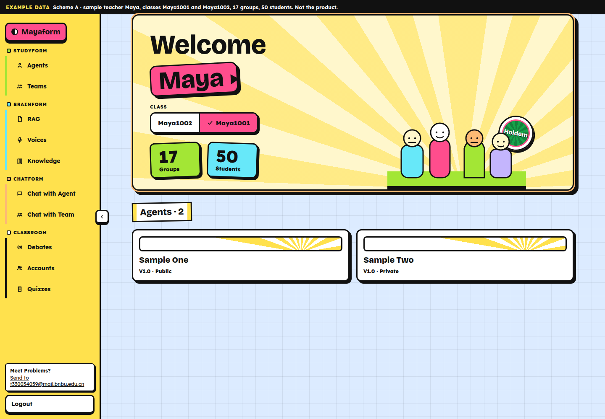

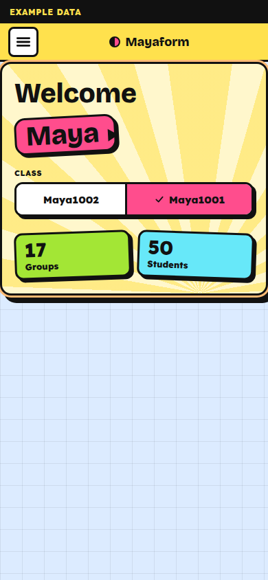

### 方案 B · 侧栏菜单，手机放在顶栏

桌面：侧栏品牌下方一个写着当前班名的白按钮，打开后列出各班，当前项粉色加勾。菜单在侧栏里往下排，不盖到右侧 banner。手机（侧栏收成抽屉）：顶栏右侧一颗 44px 的当前班按钮，banner 保持原样。收起侧栏时改成 44px 的图标按钮，`aria-label` 为 “Class Maya1001”，菜单在轨道右侧打开。键盘：Enter 或 Space 打开，方向键移动，Escape 关闭并回到按钮。

优点：切换的是全站范围，控件放在壳层，每个老师页面都用同一处。Welcome banner 内部一字不改。班再多也只是菜单变长。390 上当前班名留在顶栏，不压欢迎区。

缺点：另一个班要多点一次才看见。侧栏收起和手机抽屉都要单独做，否则当前班会在折叠后消失。打开菜单时侧栏导航被往下推。顶栏要从现在的 50px 加到 56px，当前班按钮才放得下 44px。

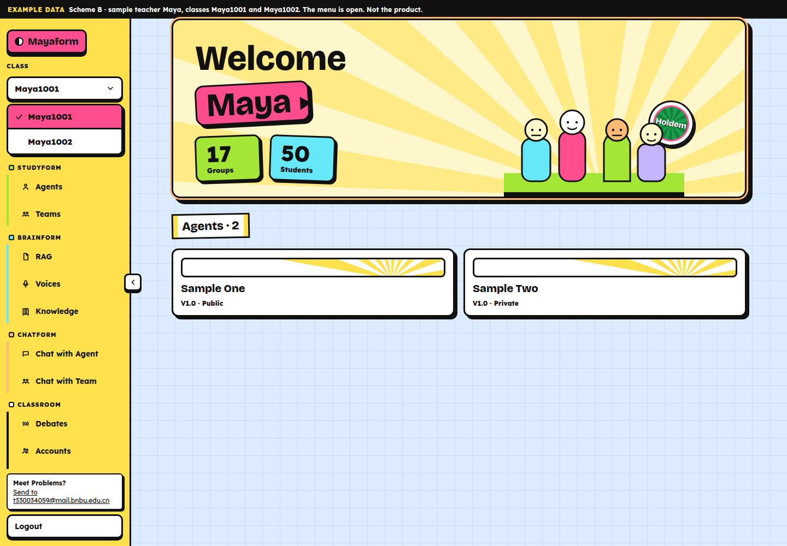

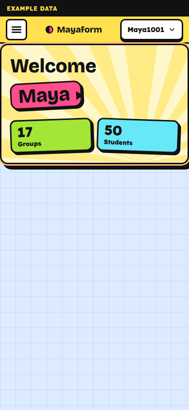

### 方案 C · 内容区顶部一条班条

首页 banner 上方单独一条白条：左边写 “Class” 和 “Current class Maya1001”，右边是同样的分段。条和 banner 之间留出蓝格子，banner 的橙环和硬阴影碰不到这条。其他老师页面用同一条，替换现在那排散按钮。

优点：当前班用句子写出来，不只靠颜色。两个班都是一击。Welcome banner 内部不动。条在文档流里，盖不住标题、统计和插画。390 上文字在上、两段各占半宽。实现就是把现有的 `TeacherClassBar` 收进这个容器。

缺点：内容区顶部仍多一行。班超过四个或班名很长时，分段要换行，那时应改用方案 B 的菜单。

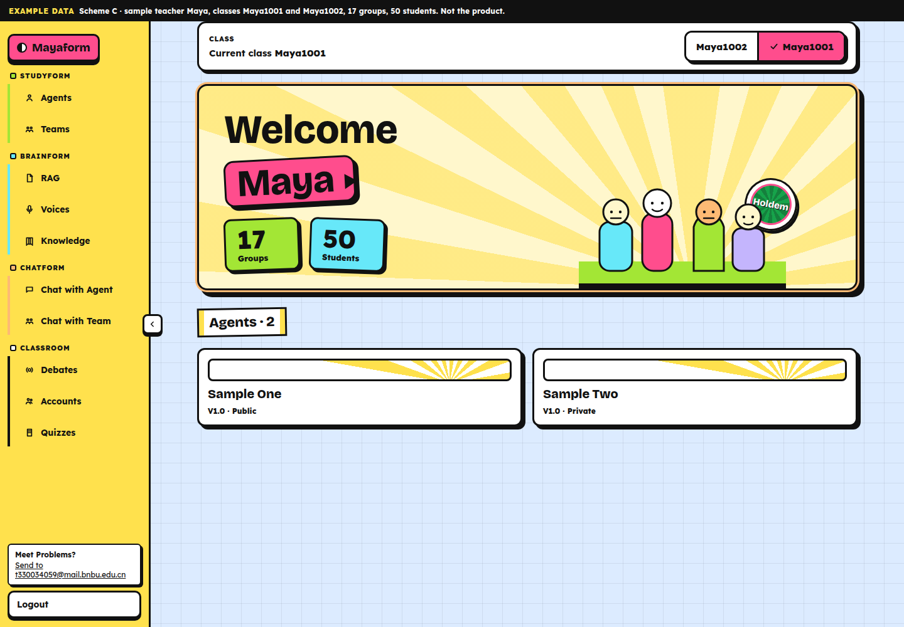

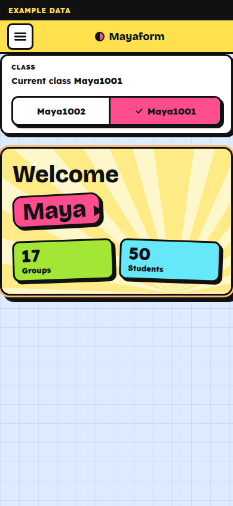

### 推荐：方案 C

现在就是两个班，Maya1001 和 Maya1002。方案 C 让当前班用文字写明，另一班留在旁边，Welcome banner 保持同事的原样，也不会再像两张贴纸浮在 banner 上。全站老师页面可以共用这一条。

如果以后班会超过四个，改选方案 B。方案 A 看起来最贴 banner，但要改首页，也解决不了其他页面。

## 1 的下一轮 · 品牌按钮带上当前班

伯闻选定方向 B，并要求品牌按钮本身带上当前班，例如「Mayaform-1001」。后缀来自 `selectTeacherCourse` 和 `TeacherClassBar` 用的同一份老师课程。示例里的课名是 Maya1001、Maya1002，品牌写成 Mayaform-1001：课名若以 Maya 开头，后缀用剩下的部分；不以 Maya 开头的课名整段接在后面，放不下就截断。点品牌主体回主页，和现在的品牌链接一样。右侧另有一个下拉，切换效果和现在的 `TeacherClassBar` 一样。只有一个班时不画下拉，品牌仍写成 Mayaform-1001。

三套都满足：两个点击区各至少 44px；Tab 能分别落到回主页和下拉上；下拉按钮带 `aria-haspopup="menu"` 和 `aria-expanded`，方向键移动，Escape 关闭并把焦点还回去；当前班靠文字和勾，不单靠颜色。粉色沿用现在的规则，表示「当前页是 Mayaform 首页」，不表示当前班。菜单里多一行很长的课名，只为展示截断，是 EXAMPLE DATA。

### B1 · 分割按钮

左边是回主页的链接，文字是 Mayaform-1001。右边是单独的 44px 白按钮，只有 ▾，中间一条 3px 黑分隔。下拉在按钮下方列出班级，当前项粉色加勾。班名变长时，Mayaform 先被省略，后缀自己再省略，避免数字先被切掉。侧栏收起后，上面一颗 44px 的圆点回主页，下面一颗 44px 的按钮写着 ▾ 和 1001，菜单从轨道右侧打开，落在 Welcome 下面。390 上同一颗分割按钮放进顶栏，菜单在顶栏下面整页展开，不盖住品牌。

优点：就是伯闻说的「右边一个下拉按钮」，两个区靠分隔线和白/粉两块分开，一眼能认。收起和手机都还是这一套，不另起一行。当前班写在品牌上。

缺点：▾ 按钮上没有 “Class” 这个词，要靠打开的菜单和读屏名称 “Switch class” 才知道它是换班。只有一个班时，整颗按钮变成没有分隔的链接。

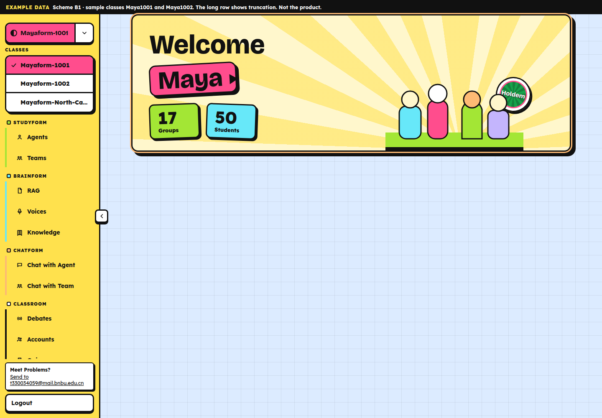

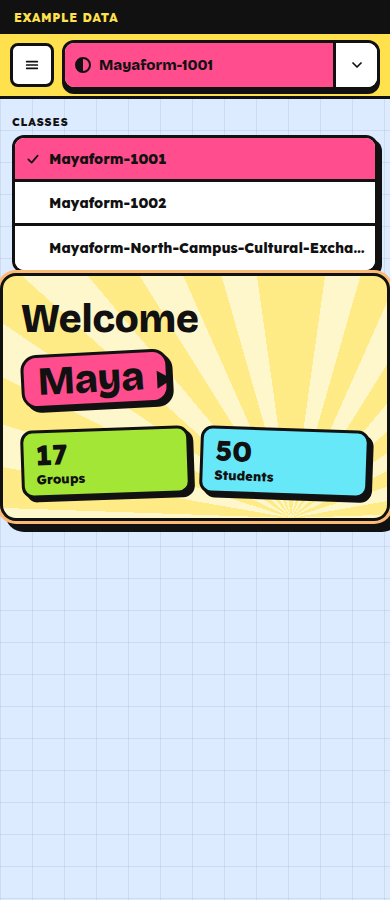

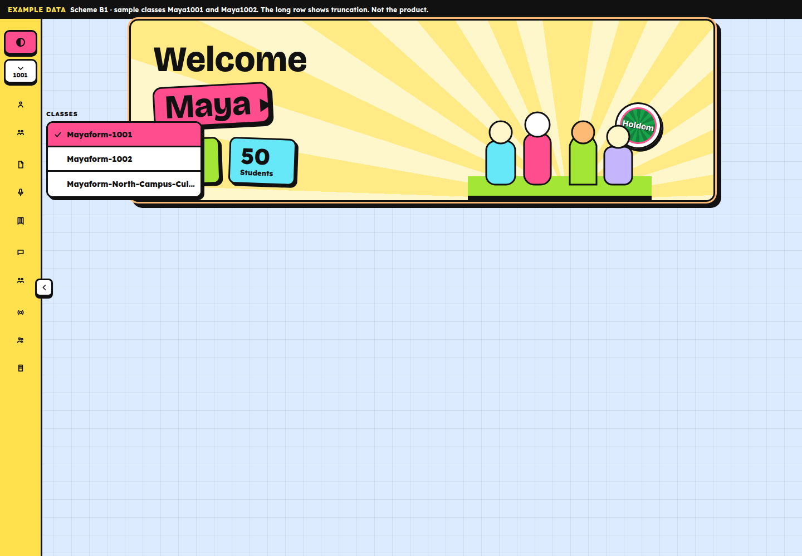

### B2 · 胶囊上的班级 chip

一颗胶囊。左边是 Mayaform，点它回主页。右边是一枚白底圆 chip，写着 1001 和 ▾，整枚 chip 才是下拉，不是单独的箭头。当前班就是 chip 上的数字，菜单里再加勾。侧栏收起后，圆点在上，圆 chip「1001」在下。390 上同一颗胶囊放进顶栏。

优点：换班的那一块自己写着班号，不必猜 ▾ 是做什么的。品牌词 Mayaform 固定，长后缀只挤 chip。

缺点：胶囊里字要比分割按钮小，窄侧栏才放得下 Mayaform 和 chip。它和 B1 都是左右分，差别主要在右边是「班号」还是「纯箭头」。

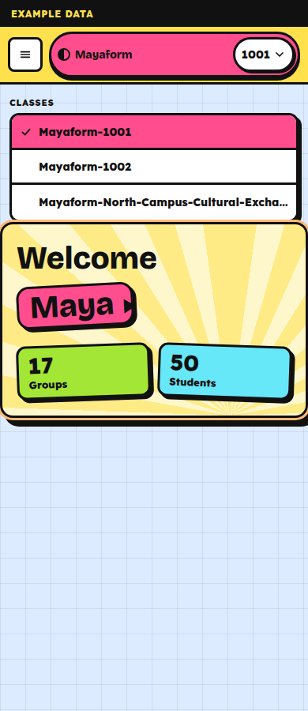

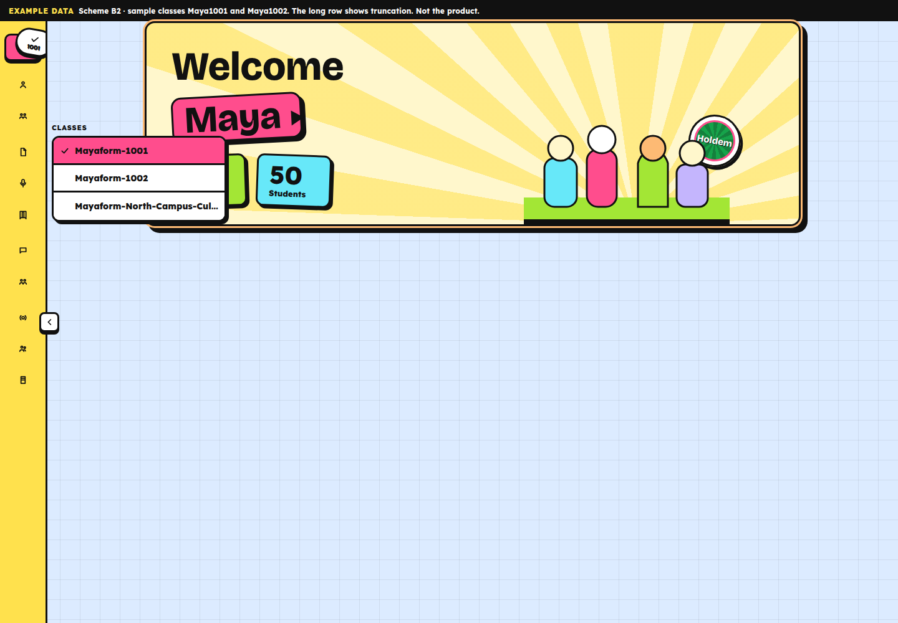

### B3 · 品牌下面一行 Class

上面的 Mayaform 保持现在的品牌链接，只负责回主页。下面另起一行 44px 的白条：「Class」、勾、1001、▾。点这一行才打开下拉。侧栏收起后，圆点在上，下面一颗 44px 的按钮分成 Class 和 1001 两行。390 上顶栏变成两行：第一行是菜单和 Mayaform，第二行是通栏的 Class 1001，菜单再往下排。

优点：两个点击区是上下两块，不可能点错。Mayaform 这个词不被班名挤。长班名有整行宽度来截断。

缺点：侧栏多占一行，手机顶栏变高。品牌不再读成「Mayaform-1001」这一串，班号在下一行。

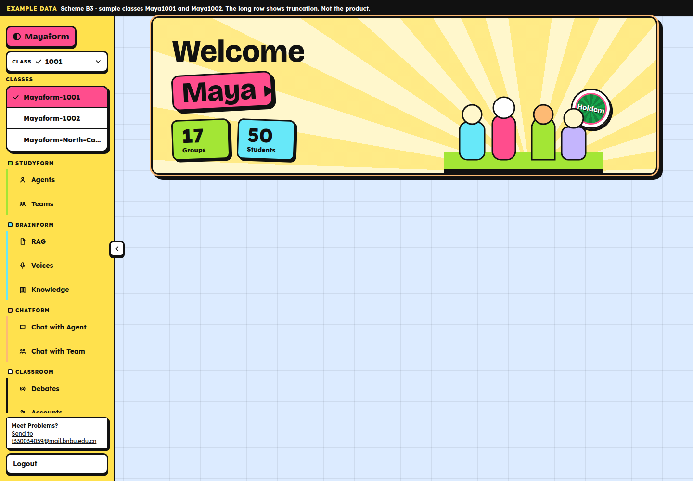

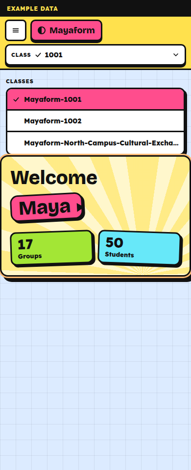

### 推荐：B1

它把当前班写进品牌，读成 Mayaform-1001，右边的 ▾ 是单独一击，中间有分隔线。两个区都到 44px，收起和 390 顶栏不用改结构。当前班靠文字和菜单里的勾，粉色仍只表示「这页是首页」。

如果希望换班的按钮上直接写着班号，用 B2。如果希望 Mayaform 四个字保持现状、班号单独一行，用 B3。

## 2. Quiz 详情页头部

### 现状

`frontend/components/quizzes/quiz-editor.tsx` 把标题和操作都放进 `PageBanner`（`frontend/components/page-banner.tsx`，黄底太阳纹来自 `frontend/components/agent-chrome.ts` 的 `AGENT_BANNER`）。标题用 `flex: 1 1 480px`，和右侧控件分同一行，所以 “Concluding Questionnaire · 终点问卷” 被挤成三行。

同一行还有五个元素：`QuizStatus` 的 LIVE 灯、Pause evaluation、Download、Back、Done。下面是 Paper / Submissions 标签，再下面是锁条 “Unpublish this quiz before editing it.” 和 Unpublish。这些键的样式在 `frontend/components/quizzes/quiz-chrome.tsx`。

2026-11-08 的选定布局（`docs/contracts/CLASSROOM_QUIZ_API.md`）把 Start / Pause 和 Download 放在 banner，Unpublish 放在锁条，每个问卷页保留 Back 和 Done。下面的方案都留着这些动作，只改它们怎么排。

### 方案 A · 标题一行，操作下一行

banner 改成上下两行。第一行是标题，LIVE 贴在这一行的右侧，标题不够宽时 LIVE 落到下一行的左边，不再把标题挤窄。第二行右对齐：Pause evaluation、Download、Back、Done，Done 保持粉色。390 上标题 28px、两行，四个键排成 2×2，每个至少 48px，图标在上、文字在下，沿用现在 600px 以下的键。

优点：示例标题在 1440 上是一行，在 390 上是两行。五个元素不再跟标题抢一行。Pause、Download、Back、Done 仍在 banner，Unpublish 仍在锁条，和 11 月 8 日的合同一致。暂停测评仍然一击。

缺点：第二行仍有四个键，桌面上 banner 还是密，只是不再压标题。

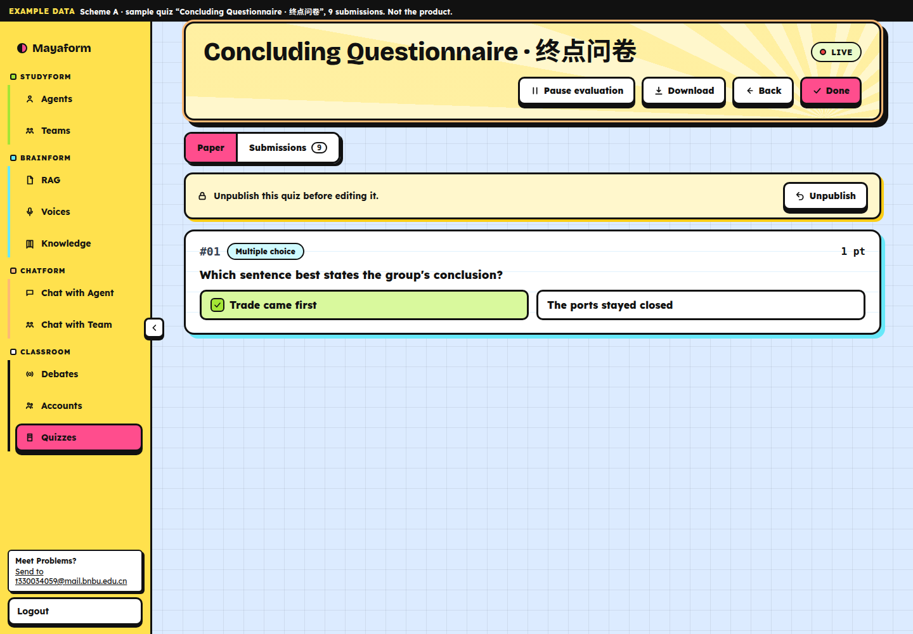

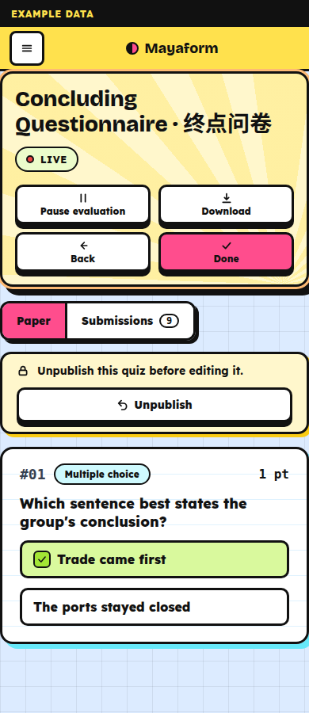

### 方案 B · Back 做成面包屑，Download 挪到锁条

banner 上方一颗 44px 的 “Quizzes”，`aria-label` 是 “Back to quizzes”，仍然回到 `/teacher/quizzes`。banner 里只留标题、LIVE、Pause evaluation 和粉色 Done。Download 跟 Unpublish 一起放在锁条上。390 上面包屑、两行标题、LIVE、两个半宽大键，锁条里 Unpublish 和 Download 并排。

优点：标题拿到整行。banner 里只剩「正在进行」和「结束并返回」两件要事。下载和取消发布都是对已发布试卷的管理，放在一起好找。

缺点：可见文案从 Back 改成 Quizzes，是一处文案变化。Download 离开了合同里写的 banner。面包屑多占一行。

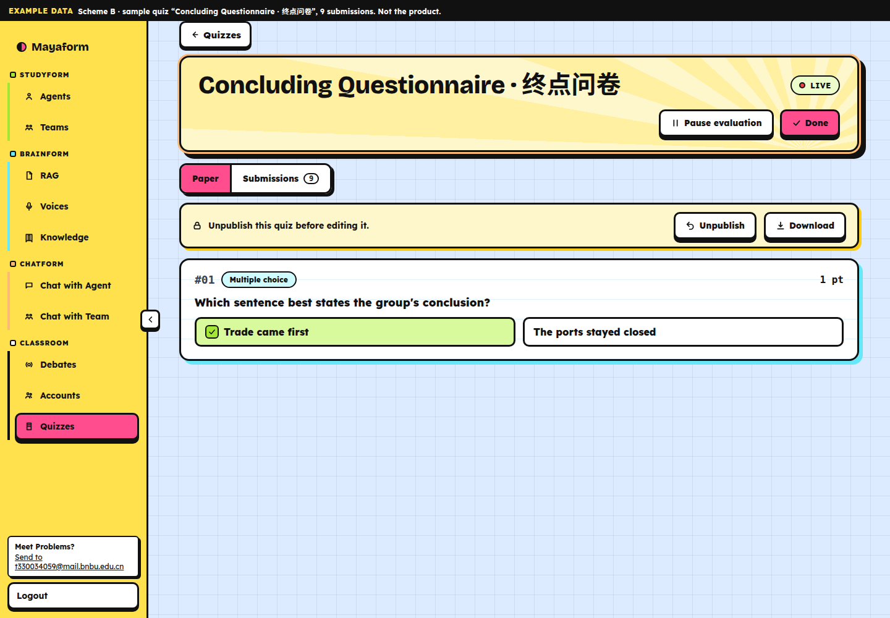

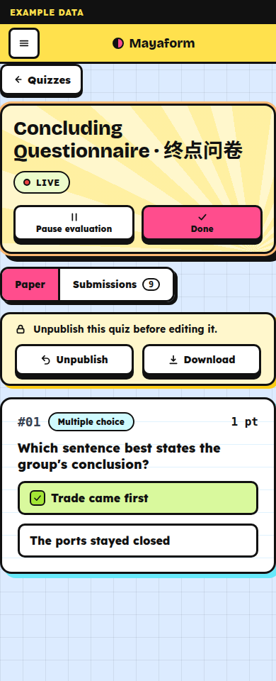

### 方案 C · 次要操作收进 More

标题和 LIVE 独占一行。旁边只留 Back、粉色 Done，和一个 44px 的 More（`aria-label` “More actions”）。打开后是 Pause evaluation 和 Download，每项至少 44px。菜单在按钮下方展开，不盖住标题。390 上菜单变成通栏两行，页面往下排，标题留在上面。键盘与方案 B 的菜单相同：方向键、Escape，焦点回到 More。

优点：banner 最干净。标题在 1440 和 390 都不跟一排键抢宽。下载这种少用的动作被收起来。

缺点：问卷正在 LIVE 时，暂停要多点一次。菜单打开时会挡住它下面的一点内容，虽然不挡标题。

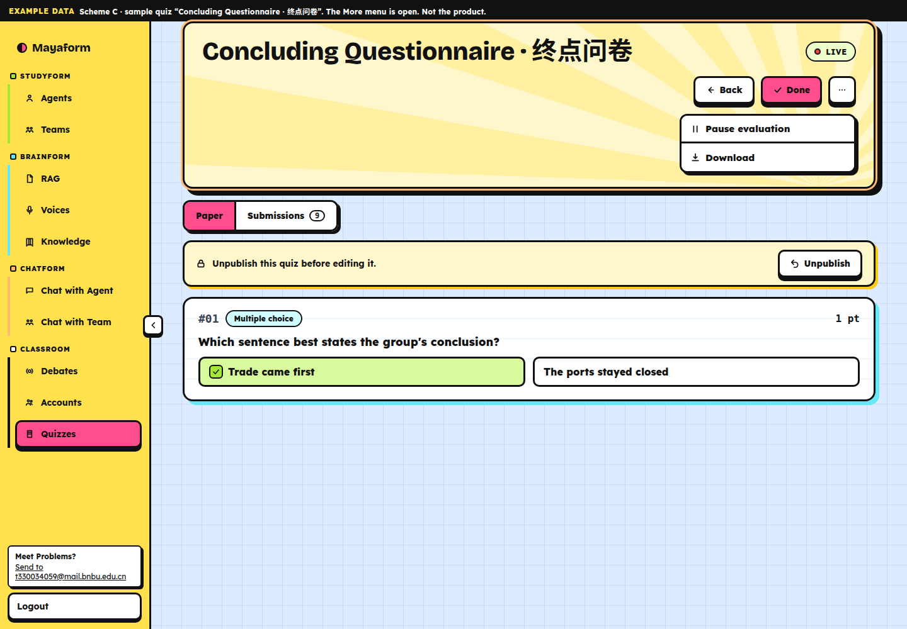

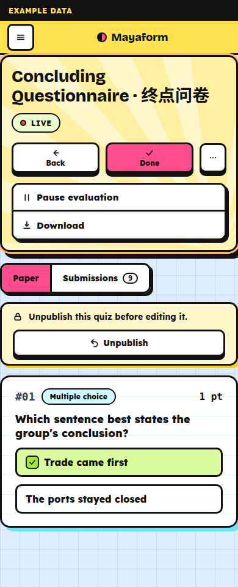

### 推荐：方案 A

它只改排列：标题不再和按钮分宽，LIVE 贴着标题，四个动作都还在 banner 里，Unpublish 还在锁条上。1440 上示例标题是一行，390 上是两行加大键。暂停测评保持一击，因为 LIVE 时老师要能马上停。

如果希望 banner 再安静，并且接受 Download 挪到锁条、Back 改成 “Quizzes”，用方案 B。方案 C 把暂停藏进菜单，不适合作为默认。
